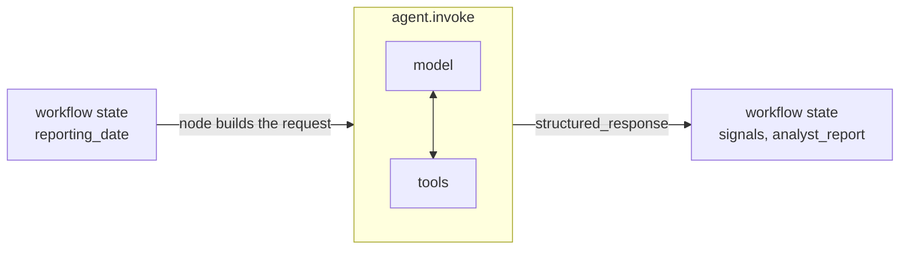

# Agents in LangChain

> An agent is a model that can use tools in a loop: it asks for data, reads it, and decides again, until it has an answer.

## Context

In [[The hackathon task]], the first member of the team is the **analyst**. Its job is: *"Give a high, neutral or low signal for every asset, as of 31 January 2025."*

**With a plain model call**, you send that sentence to the LLM and get one reply back. The LLM has no price data, so it can only guess or invent. One call is one answer, and nothing in between.

**With an agent**, the same request goes like this:
1. The model reads the request and the list of tools it may use. 
2. It sees that there is a toll called `get_asset_statistics`.
3. It then replies: *"call `get_asset_statistics` with 90 days."*
4. Your program runs that function on the real price data and gives the model the numbers.
5. The model reads the numbers and wants a longer view: *"call it again with 365 days."* That runs too.
6. With both results, the model writes its answer: a signal per asset and a short reason.

The model never run or touch the data. It only *asked* for a given function with args, and the program did the work ([[What is a tool]]). 

This flow, "model decides → program runs the tool → model reads the result" is the **agent loop** ([[The agent loop in LangChain]]). An **agent** is a model plus tools plus that loop.

## `create_agent`

LangChain builds the loop for you. You describe the agent with a few parts:

| Part | What it means | The analyst's |
|---|---|---|
| model | the LLM that makes the decisions | `llm` |
| `system_prompt` | standing instructions, sent before everything else: who the model is and what to do | "You are a market analyst. Use get_asset_statistics, then submit one signal…", plus its skills ([[Skills in LangChain]]) |
| `tools` | the functions the model may ask for | `get_asset_statistics` |
| `response_format` | the exact form of the final answer, checked by code | `ToolStrategy(Analysis)`: a signal per asset + rationale ([[Schemas in LangChain]]) |
| `context_schema` | data your code passes in that the model **never sees**, so it can't change it | `AgentContext`: the reporting date |
| `middleware` | your own code, run at fixed points of the loop | adds the date to the prompt, retries, limits ([[Middleware in LangChain]]) |

Only the model is required. The template's `risk_manager` has no tools and no `response_format`: it reads the numbers it's given and answers once, in plain text. That is still an agent, just one whose loop runs a single [[What is a turn|turn]].

## Running it
`agent.invoke(...)` starts the loop. You give it the first **message** (the request, as if typed by a user) and the context. 

When the loop ends, you get back the agent's final **state**, a dict with:
- `messages`: the whole conversation, i.e. the request, every tool call, every result and the final reply;
- `structured_response`: the checked answer (an `Analysis` object), present only if there's a `response_format`.

```python
# agents.py, analyst (shortened)
agent = create_agent(
    llm,
    system_prompt=ANALYST + skills_prompt("signals", "rates"),
    tools=[get_asset_statistics],
    response_format=ToolStrategy(Analysis, handle_errors=True),
    context_schema=AgentContext,
    middleware=middleware,
)
result = agent.invoke(
    {"messages": [HumanMessage(content="Analyse the assets.")]},   # the request
    context=AgentContext(state["reporting_date"]),                  # hidden from the model
)
analysis = result["structured_response"]      # Analysis(signals={...}, rationale="...")
return {"signals": analysis.signals, "analyst_report": analysis.rationale}
```

The last line is the hand-off. The agent runs inside one step (**node**) of the system's workflow. The node turns the workflow's data into the agent's request, and turns the agent's answer back into the workflow's data ([[State in LangChain]]):



## Watch out
- **The agent may finish without an answer.** If a call limit stops it, `structured_response` is missing. `structured_answer()` raises a clear error instead of passing `None` on.
- **Prompt or context?** Put what the model must *read* in the prompt or the message. Put what it must *not* change (the date) in the context.

## Related
[[What is a tool]] · [[What is a turn]] · [[The agent loop in LangChain]] · [[Tools in LangChain]] · [[Hooks in LangChain]] · [[Middleware in LangChain]] · [[Schemas in LangChain]] · [[State in LangChain]] · [[Workflow in LangChain]] · [[Skills in LangChain]]


