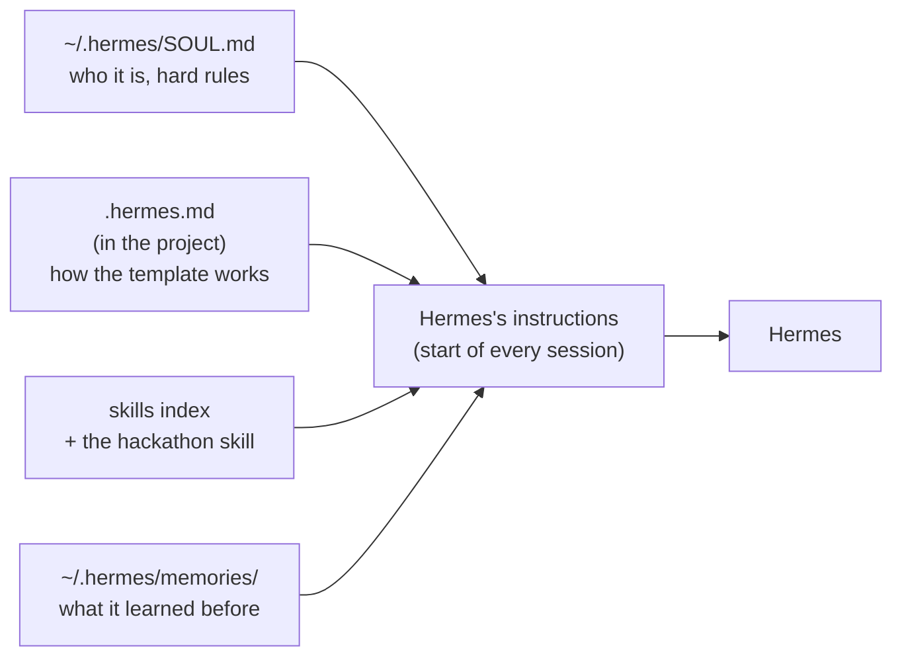

# Hermes coding agent

> Hermes is the AI coding agent in your team's workspace. It reads the project's instructions, knows the hackathon's rules, and can edit and run the template for you. You talk to it in a terminal, and steer it with plain messages and a few slash commands.

## Context

Your team wants the analyst to use macro data as well as prices. You could read `utils/data.py`, write a new tool, wire it into the agent and run a date. Or you can open Hermes and type:

```text
Add a tool to the langgraph analyst that reads the latest values of a macro series from
macro.csv, cut at the reporting date. Run 2025-01-31 and tell me if the analyst used it.
```

Hermes already knows where tools go, that data must be cut at the reporting date, how to run a date, and that the shared Python environment must not be touched. It knows because of a few files that are loaded into it before you type anything. This note explains how to start it, those files, the skills, and the commands you'll use.

## Starting Hermes

1. **Open a terminal** in JupyterLab: *File → New → Terminal*, or the *Terminal* tile in the Launcher.
2. **Go to the template folder:** `cd langgraph-template`
3. **Start Hermes:** `hermes`

![[hermes-start-terminal.png]]

Starting it *inside* `langgraph-template` matters: that's how Hermes finds the project's `.hermes.md` (next section).

Hermes opens with a welcome screen:

![[hermes-welcome.png]]

What it shows:
- **Available Tools**: what Hermes can do by itself, such as reading and writing files (`file`), running code (`code_execution`), or browsing (`browser`).
- **Available Skills**: the workspace skills it can open when a task needs them (see *Skills* below).
- **Bottom left**: the model it's using, the folder it started in (check it says `/home/jovyan/langgraph-template`), and the session id.
- **The status bar** above the prompt: the current model, how full the context is, and how long the last turn took.
- **The prompt** (`❯`) at the bottom: type your request here, or a `/command`.

**First thing to check: the model.** If the welcome screen shows a weak model, switch to a strong tool caller before you start, e.g. `/model openai/gpt-oss-120b` (as in the screenshot, where it was switched to `openai/gpt-oss-20b`). The switch lasts for this session; add `--global` to keep it.

To leave Hermes, type `/quit` (or press `Ctrl+D` on an empty prompt). To pick up where you left off later, run `hermes -c` in the same folder.

## What Hermes knows

When you start a session, Hermes builds its instructions from these sources:



| File | Where | What it's for |
|---|---|---|
| **`SOUL.md`** | `~/.hermes/SOUL.md` | Hermes's identity and **hard rules** for this workspace: never rebuild the shared Python environment, never upgrade pinned packages, never read or print secrets, respect teammates' files. Always loaded. |
| **`.hermes.md`** | the project folder | The template's manual for the agent: what the project is, what the team delivers, the hard rules for `core/`, the look-ahead rule, the project layout, how a date runs, the limits, and *where each kind of change goes*. Loaded when Hermes starts in the project. |
| **`config.yaml`** | `~/.hermes/config.yaml` | Settings: the `hackathon` skill is loaded in every session; Hermes may add or update skills and memories without asking. |
| **`skills/`** | `~/.hermes/skills/` | Extra know-how, loaded when needed (next section). |
| **`memories/`** | `~/.hermes/memories/` | Things Hermes decided to remember across sessions. |

Two things to know:
- **Start Hermes inside the project folder.** That's how it finds `.hermes.md`. Started elsewhere, it has its rules (`SOUL.md`) but not the template's manual.
- **These files are read at the start of a session.** If you edit `.hermes.md`, start a new session (`/new`) for Hermes to see the change.

## Skills

A **skill** is a folder with a `SKILL.md`. Hermes always has the *list* of skills and opens a skill's full text only when a task needs it, so its instructions stay short.

The workspace comes with four:

| Skill | Use it for |
|---|---|
| **`hackathon`** | Start here: what the template is, how to run it, where the data and models come from, which other skill to open. **Loaded in every session.** |
| **`stackit-models`** | Calling the models: the exact model ids (case-sensitive), how to list what the proxy serves, and fixes for "invalid model name" and tool-call errors. |
| **`polymarket`** | The prediction-market data library: finding events and markets, price histories as DataFrames, the id mix-ups that return empty results. |
| **`langgraph`** | Multi-agent patterns (supervisor, swarm, hierarchical), persistence, evaluations and debugging, with ready-made templates. |

You don't have to do anything for Hermes to use them. 

Optionally, you can also call one explicitly by typing its name as a command:

```text
/polymarket find the ECB rate-decision markets and get their daily odds up to 2025-01-31
```

Hermes can also **write its own skills**. If you solve something tricky together, ask it to save the method as a skill, and the whole team can use it.

## Commands you'll use the most

Type these in the Hermes prompt.

**Sessions**

| Command | What it does |
|---|---|
| `/new` | Start a fresh session: clean context, files reloaded. Use it when you switch task or Hermes gets confused. |
| `/resume [name]` | Go back to an earlier session (`/sessions` lists them). From the shell: `hermes -c` resumes the last one. |
| `/title <name>` | Name the session, so you can resume it later by name. |
| `/undo` · `/retry` | Remove the last exchange · resend your last message. |
| `/compress` | Summarise a long conversation to free up context. |
| `/context` · `/usage` | What's taking up the context · tokens used. |

**The model**

| Command | What it does |
|---|---|
| `/model` | Show which model Hermes is using. |
| `/model <name>` | Switch model for this session. Use the exact id (e.g. `openai/gpt-oss-120b`), see the `stackit-models` skill. |

**While Hermes is working**

| You want to | Do |
|---|---|
| **stop it now** | `Ctrl+C` with an empty prompt. Twice quickly exits Hermes. |
| **correct it mid-way** | Just type the correction and press Enter: it redirects the current task, keeping what's done. |
| **add a hint without stopping it** | `/steer <note>`: it reads the note after its next step. |
| **give it the next task** | `/queue <prompt>`: it starts after the current one finishes. |
| **ask a quick side question** | `/btw <question>`: answered without interrupting. |
| **stop background processes** | `/stop`: kills processes it started in the background (e.g. a long run). |

**Other useful ones**

| Command | What it does |
|---|---|
| `/plan <task>` | Write a plan first, without changing anything. Good for big changes. |
| `/diff` | Show the git changes Hermes made. |
| `/rollback` | Restore files from a checkpoint if a change went wrong. |
| `!<command>` | Run a shell command yourself, e.g. `!git status`. |
| `/help` | All commands. |

## Steering Hermes well

- **Say what, where and how to check.** "Add a risk rule that caps any single asset at 30%, in the langgraph system, and run 2025-01-31" works better than "improve the risk".
- **Plan big changes first.** `/plan`, read it, then say "go". Small steps are easier to check than one large change.
- **Ask for proof.** "Run one date and show me the weights", or "open the Langfuse trace and tell me which tools the analyst called."


## Watch out
- **Don't press `Ctrl+C` to paste into Hermes.** In the terminal, `Ctrl+C` means *stop*, so it kills your session and all its context. To paste, **right-click → Paste**.
- **It shares your workspace.** Teammates may have the same files open. Hermes is told not to overwrite their work, but tell it which files are yours to change.
- **It can't break the rules for you.** It won't edit `core/`, rebuild the environment or touch secrets, even if asked. That's on purpose: those protect your submission and your teammates.


## Related
[[Tracing and Langfuse]] · [[Introduction]]

