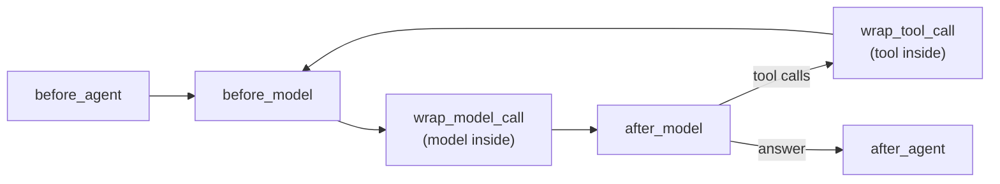

# Hooks in LangChain

> A hook is a named moment in the agent's loop, like "before each model call" or "after the agent answers", where LangChain calls your function.

## Context

Here is the [[Agents in LangChain#Context|running example]] as a timeline, with the moments where the analyst's middleware runs ([[Middleware in LangChain]]):

| Moment in the run                                                    | Hook                 | Analyst's middleware that runs                                                                                                                                  |     |
| -------------------------------------------------------------------- | -------------------- | --------------------------------------------------------------------------------------------------------------------------------------------------------------- | --- |
| the agent starts                                                     | `before_agent`       | none                                                                                                                                                            |     |
| step 1: just before the model call                                   | `before_model`       | `call_limit()` checks the count, and ends the agent if it's over `MAX_MODEL_CALLS`                                                                              |     |
| step 1: around the model call                                        | `wrap_model_call`    | `reporting_date_prompt` adds the date to the prompt; `ModelRetryMiddleware` retries server errors; `retry_invalid_tool_calls` asks again if the reply is broken |     |
| step 3: the model has replied "call `get_asset_statistics`, 90 days" | `after_model`        | `call_limit()` counts the model call; `tool_call_limit()` counts the requested tool calls and refuses those over `MAX_TOOL_CALLS`                               |     |
| step 4: the program runs the tool                                    | `wrap_tool_call`     | none in the template                                                                                                                                            |     |
| step 5: the model asks again                                         | the same hooks again | every [[What is a turn]] repeats the rows above                                                                                                                 |     |
| step 6: the agent has answered                                       | `after_agent`        | none for the analyst; the portfolio manager's `UsExposureGuardrail` runs here                                                                                   |     |

Each row is a **hook**: a fixed moment in the loop where LangChain stops and calls every function registered for that moment. You don't write the loop ([[The agent loop in LangChain]]), so hooks are the only places your code can run inside it.



## Two kinds of hook

**Step hooks** (`before_agent`, `before_model`, `after_model`, `after_agent`) run *between* steps. Your function receives the agent's **state** (the messages so far, plus any keys you added). It returns a dict of keys to update, or `None` to change nothing.

**Wrap hooks** (`wrap_model_call`, `wrap_tool_call`) run *around* one call. Your function receives the **request** (messages, prompt, tools) and a `handler`, the function that actually makes the call. You decide what happens: change the request, call `handler`, look at the result, call it again, or return something else.

```python
# wrap hook: call the model; if the tool call came back broken, show the error and call again
@wrap_model_call
def retry_invalid_tool_calls(request, handler):
    response = handler(request)                       # the real model call
    message = response.result[-1]
    if message.invalid_tool_calls:
        request = request.override(messages=[*request.messages, message, *errors])
        response = handler(request)
    return response

# step hook: once, at the end; reads the state, writes new keys
class UsExposureGuardrail(AgentMiddleware[RiskState]):
    def after_agent(self, state, runtime):
        ...
        return {"approved_weights": approved, "risk_review": {...}}
```

Use a **wrap** hook when you need the call itself (retry it, change the prompt, time it). Use a **step** hook when you only need to read or update the state. `@dynamic_prompt` is a shortcut: a wrap hook that only changes the system prompt.

## Watch out
- **Stopping the run.** A step hook can end the agent early by returning `{"jump_to": "end"}`, after declaring `can_jump_to=["end"]`. That's how `call_limit()` stops after `MAX_MODEL_CALLS`.
- **Every-turn hooks run a lot.** In the example, `before_model` and `wrap_model_call` run on every turn. Keep them fast.

## Related
[[Middleware in LangChain]] · [[The agent loop in LangChain]] · [[Agents in LangChain]] · [[State in LangChain]] · [[What is a turn]]


