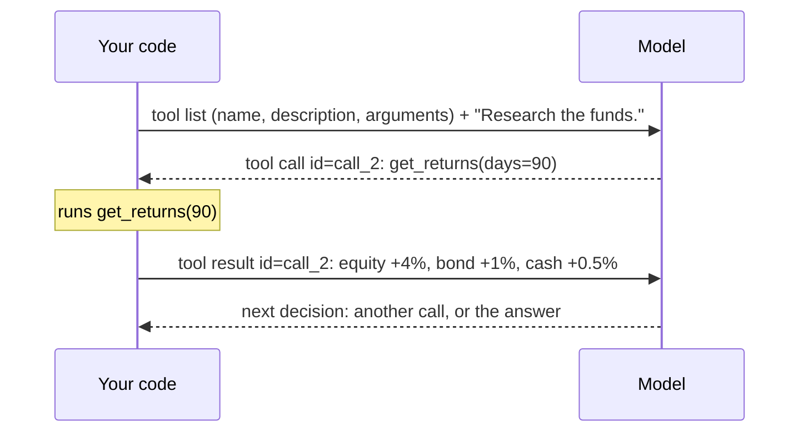
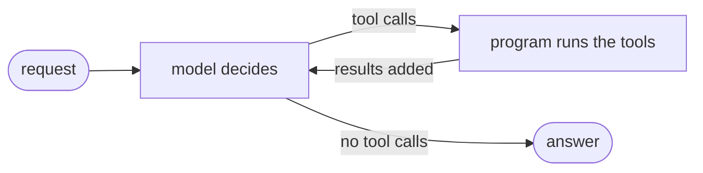

# Introduction

> The choice between **LangChain and LangGraph**, which differ in who writes the agent's loop, and three ideas behind every agent, whatever the library: a **tool** the model can ask for, the **loop** that lets it work in rounds, and the **turn** that is one round of it.

All the examples below use the same small system: agents that build a portfolio from three made-up funds (equity, bond and cash), with at most 40% in equity. A **researcher** measures the funds with two tools: `get_returns(days)`, for at most 365 days, and `get_volatility(fund)`. A **strategist** turns its notes into weights, a **risk check** enforces the limit, and a **writer** explains the result.

## LangGraph vs LangChain

> LangChain gives you a ready-made agent: you describe it, it runs the loop. LangGraph gives you the pieces: you draw every step yourself. Pick by how much of the loop you want to control.

Both libraries can build the portfolio system: the researcher's 4 turns, the strategist corrected once, the risk check that fixes the weights. The question is who writes the loop *"call the model → run the tools → call the model again"*: the library, or you. (The tool, the loop and the turn are explained in the sections below.)

| | LangChain (`create_agent`) | LangGraph (`StateGraph`) |
|---|---|---|
| **You write** | the agent's parts: model, prompt, tools, answer form, middleware | every step as a node, and the edges between them |
| **It hides** | the loop: the model and tools steps, when to stop, error handling | nothing: what you don't draw doesn't happen |
| **Good at** | getting an agent with tools running in a few lines | custom control flow: branches, loops with your own rules, parallel steps |
| **Your own logic goes** | in middleware, at fixed moments of the loop ([[Hooks in LangChain]]) | in any node, anywhere in the graph |
| **The risk check** | middleware after the strategist answers | its own node, with a branch after it |
| **When it's hard** | you need control *between* the loop's fixed moments | you rewrite things LangChain gives for free (retries on a bad answer, limits) |

They aren't rivals: `create_agent` **builds a LangGraph graph**, and a common setup uses both. The workflow (researcher → strategist → writer) is a LangGraph graph, and each step runs a LangChain agent ([[Workflow in LangChain]]).

How to choose:
- **Start with LangChain** if each step is "an agent that uses some tools and returns an answer". You'll have it running quickly, and middleware covers most custom needs.
- **Use LangGraph** if the order of steps depends on results (send the strategist back with feedback, run two researchers in parallel), or you want every step visible in the graph.
- **Mix them** when the overall flow is custom but each step is a normal agent: a LangGraph workflow whose nodes call `create_agent` agents.

References: [LangChain docs: Agents](https://docs.langchain.com/oss/python/langchain/agents) · [LangGraph docs: Overview](https://docs.langchain.com/oss/python/langgraph/overview) · [LangGraph docs: Thinking in LangGraph](https://docs.langchain.com/oss/python/langgraph/thinking-in-langgraph)

## What is a tool

> A tool is a function the model can't run but can **ask** you to run. The model writes the request, your code runs the function, and the model reads the result.

A model only reads and writes text: it can't open a file, query a database or call an API. A **tool** gives it a way to get things done anyway: the model is told which functions exist, and when it needs one it writes a request for it. Your program runs the function and hands the result back. The model never runs any code.

A tool is made of:
- a **name**: how the model refers to it;
- a **description**: what the tool does and when to use it;
- **arguments**: the inputs, with their types and limits.

When the model uses it, two more things appear:
- the **tool call**: the model's request, with the tool's name, the argument values, and an **id**;
- the **tool result**: what the function returned, sent back with the same id, so the model knows which request it answers.

Every tool call follows the same four steps:
1. **You describe** each tool to the model (name, description, arguments).
2. **The model decides**: it replies either with text, or with one or more tool calls.
3. **Your code runs it** with the arguments the model chose.
4. **The result goes back** to the model, which decides again ([[#What is a loop|the loop]]).

In LangChain, a tool is an ordinary Python function marked with `@tool`: its name becomes the tool's name, its docstring the description, and its type hints the arguments. `create_agent` sends the descriptions to the model and runs the calls for you ([[Tools in LangChain]]):

```python
from typing import Literal
from langchain.tools import tool

@tool
def get_volatility(fund: Literal["equity", "bond", "cash"]) -> dict:
    """Annualised volatility of one fund, in %: how much its price moves up and down."""
    ...
```

In LangGraph, the tool is written the same way, but you do the other two steps yourself: `model.bind_tools([...])` sends the descriptions to the model, and a `ToolNode` in the graph runs the calls ([[Tools in LangGraph]]):

```python
reply = model.bind_tools([get_volatility]).invoke(messages)    # the model may ask for it
graph.add_node("tools", ToolNode([get_volatility]))             # the graph runs it
```

The researcher needs the funds' returns, which it can't fetch itself, so it *writes* a request for `get_returns`, and your program runs it:



A reply can hold **several** tool calls: the researcher can ask for `get_volatility("equity")` and `get_volatility("bond")` at once, and both run in the same [[#What is a turn|turn]].

Watch out:
- **The model can call it wrong**, e.g. `days=500` when the limit is 365. Check the arguments, and send the error back so the model can fix its call ([[Schemas in LangChain]], [[Tools in LangGraph]]).
- **Don't let the model choose what it shouldn't.** The list of funds isn't an argument: your code passes it in, so the model can't add a fund it shouldn't use ([[Runtime in LangChain]], [[Runtime in LangGraph]]).
- **Every call is a round trip** to the model. A loop of tool calls needs a limit ([[Limits in LangChain]], [[Errors and retries in LangGraph]]).

References: [Hugging Face Agents Course: What are tools?](https://huggingface.co/learn/agents-course/unit1/tools) · [Hugging Face Agents Course: Actions](https://huggingface.co/learn/agents-course/unit1/actions) · [LangChain docs: Tools](https://docs.langchain.com/oss/python/langchain/tools) · [LangGraph docs: Workflows and agents](https://docs.langchain.com/oss/python/langgraph/workflows-agents)

## What is a loop

> The agent loop is the cycle *model decides → program runs the tools → model reads the results*, repeated until the model answers without asking for a tool. It's what turns a single model call into an agent.

A single model call answers once, from what the model already knows. Many tasks can't be done that way: the model needs information it doesn't have, and what it asks for next depends on what it learned before. The **loop** lets it work in rounds: ask for something, read the answer, decide again. Each round is a [[#What is a turn|turn]].

The loop has five parts:
- **the model's decision**: it reads everything so far and replies with tool calls, or with a final answer;
- **running the tools**: your program carries out the calls the model asked for ([[#What is a tool|tools]]);
- **the conversation**: every request, call and result, resent on every turn. It's the model's only memory;
- **a stop condition**: a reply without tool calls is the answer, and the loop ends;
- **a limit**: a maximum number of turns or calls, in case the model never stops.



The idea is the same in every framework; what changes is who writes the loop ([[#LangGraph vs LangChain|LangGraph vs LangChain]]):
- in **LangChain**, `create_agent` runs it for you, as a `model` step and a `tools` step, and you add code at fixed moments ([[The agent loop in LangChain]]);
- in **LangGraph**, you draw it yourself: a model node, a tools node (`ToolNode`), a router after the model (`tools_condition`) and an edge back. The stop condition and the limit are yours to write too ([[The agent loop in LangGraph]]).

The researcher can't decide which funds' risk to check before it has seen their returns, and it can't fix a bad call before it sees the error. So it works in four turns:
1. it asks for `days=500` and reads the error: at most 365;
2. it asks for `days=90`: equity +4%, bond +1%, cash +0.5%;
3. it asks for the volatility of equity and bond: 15% and 5%;
4. it writes its notes, with no tool call, so the loop ends.

Each part of the loop shows up here: the **conversation** keeps the returns from turn 2 available at turn 4, the error at turn 1 lets it **recover**, and turn 4 is the **stop condition**. A **limit** (say, 8 model calls and 6 tool calls) would stop it if it kept asking for more: middleware in LangChain ([[Limits in LangChain]]), your own count in LangGraph ([[Errors and retries in LangGraph]]).

Watch out:
- **Every turn costs more than the last.** The whole conversation is resent each time, so long loops with big tool results get slow and expensive.
- **A loop without a limit can run forever**, or until something crashes.

References: [Hugging Face Agents Course: the Thought-Action-Observation cycle](https://huggingface.co/learn/agents-course/unit1/agent-steps-and-structure) · [Hugging Face Agents Course: Observations](https://huggingface.co/learn/agents-course/unit1/observations) · [LangChain docs: Agents](https://docs.langchain.com/oss/python/langchain/agents) · [LangGraph docs: Workflows and agents](https://docs.langchain.com/oss/python/langgraph/workflows-agents)

## What is a turn

> A turn is one round of the agent loop: **one model call**, plus running the tools that call asked for. A **graph step** is smaller: one of the internal steps a turn is made of.

An agent doesn't answer in one go. It works in rounds, like a conversation with an assistant who can look things up: you ask, it decides it needs some data, it asks for it, reads it, and decides again. Each of those rounds is a **turn**:
1. the model is called once, with the whole conversation so far, and replies;
2. if the reply asks for tools, they run, and their results are added to the conversation.

Then the next turn starts with the next model call. A reply that asks for no tools is the answer, and that's the **last turn**.

The simplest way to count turns is to count **model calls**: one turn, one model call. That's also why turns matter: every turn is a model call that resends the whole conversation, so turns are what an agent is limited by, and paid for.

Three units are worth telling apart:
- a **turn**: one model call plus the tools it asked for;
- a **tool call**: one request to run one tool. A turn has zero, one or several;
- a **graph step**: one run of one step of the agent's graph. Both libraries run an agent as a graph, a set of steps connected by arrows: LangChain builds it for you, and in LangGraph you draw it. A turn is usually several graph steps.

**In LangChain**, `create_agent` builds the agent as a graph ([[The agent loop in LangChain]]). What counts as a graph step:
- **`model`**: one step per turn, the model call;
- **`tools`**: one step **per tool call**, so a turn with two tool calls has two;
- **each node-style hook** (`before_model`, `after_model`, …): one step each, every turn ([[Hooks in LangChain]]);
- **wrap-style hooks** (`wrap_model_call`, `@dynamic_prompt`, …): no step of their own, they run inside the `model` or `tools` step.

Each unit has its own limit: turns → the model call limit (`ModelCallLimitMiddleware`); tool calls → the tool call limit (`ToolCallLimitMiddleware`); graph steps → the recursion limit ([[Limits in LangChain]]).

**In LangGraph**, you draw the graph yourself, so the steps are your nodes ([[The agent loop in LangGraph]]):
- **the model node**: one step per turn;
- **the `ToolNode`**: one step per turn that asked for tools, however many calls it holds: it runs them all together;
- **any other node** you add: one step each time it runs.

There are no ready-made limits on turns or tool calls: you count them yourself in the model node. Only the graph steps have a built-in limit, the recursion limit ([[Errors and retries in LangGraph]]).

The researcher's run takes **4 turns** and **4 tool calls**:

| Turn | The model call: it reads all messages and replies… | …then the tools run |
|---|---|---|
| 1 | "call `get_returns(days=500)`" | rejected: days must be ≤ 365; the error is added to the messages |
| 2 | "call `get_returns(days=90)`" | runs; the returns are added |
| 3 | "call `get_volatility("equity")` and `get_volatility("bond")`" | both run; both results are added |
| 4 | the notes, with no tool call | nothing to run, so the loop ends |

**Counted in graph steps**, the same run takes:
- **8 steps in LangChain without middleware**: `model`, `tools` for turns 1 and 2; `model`, `tools`, `tools` for turn 3 (one `tools` step per tool call); `model` for turn 4;
- **20 steps in LangChain with a model call limit and a tool call limit**, which run as hooks before and after each model call: turn 1 alone is 5 steps, `before_model` → `model` → `after_model` → `after_model` → `tools`;
- **7 steps in a hand-written LangGraph loop**: `researcher`, `tools` for each of turns 1–3 (turn 3's two calls run in one `tools` step), then `researcher` for turn 4.

So 4 turns can be 7 or 20 graph steps: a model call limit of 8 is a limit on turns, while the recursion limit has to leave room for all the steps those turns take.

Watch out:
- **Each turn resends everything.** The model has no memory between calls: more turns cost more time and tokens.
- **Every hook you add makes each turn longer in graph steps.** If you add middleware, check that the recursion limit is still well above what your turns need.
- **"Turn" in chat apps** sometimes means one message from one side. In these notes, a turn is always one model call plus its tools.

References: [Hugging Face Agents Course: the Thought-Action-Observation cycle](https://huggingface.co/learn/agents-course/unit1/agent-steps-and-structure) · [LangChain docs: Built-in middleware (model and tool call limits)](https://docs.langchain.com/oss/python/langchain/middleware/built-in) · [LangGraph docs: Graph API (super-steps and the recursion limit)](https://docs.langchain.com/oss/python/langgraph/graph-api)

## Where to go from here

| LangChain | LangGraph |
|---|---|
| **[[A Brief Overview on LangChain]]** (start here) | **[[A Brief Overview on LangGraph]]** (start here) |
| [[Agents in LangChain]] | [[State in LangGraph]] |
| [[The agent loop in LangChain]] | [[Workflow in LangGraph]] |
| [[Tools in LangChain]] | [[Agents in LangGraph]] |
| [[Runtime in LangChain]] | [[The agent loop in LangGraph]] |
| [[Schemas in LangChain]] | [[Tools in LangGraph]] |
| [[Skills in LangChain]] | [[Runtime in LangGraph]] |
| [[Hooks in LangChain]] | [[Schemas in LangGraph]] |
| [[Middleware in LangChain]] | [[Branches in LangGraph]] |
| [[Limits in LangChain]] | [[Errors and retries in LangGraph]] |
| [[State in LangChain]] | |
| [[Workflow in LangChain]] | |

## Related
[[A Brief Overview on LangChain]] · [[A Brief Overview on LangGraph]] · [[Tracing and Langfuse]]
