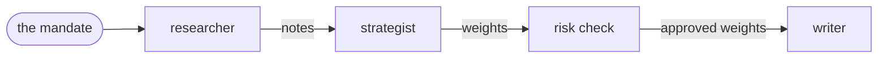
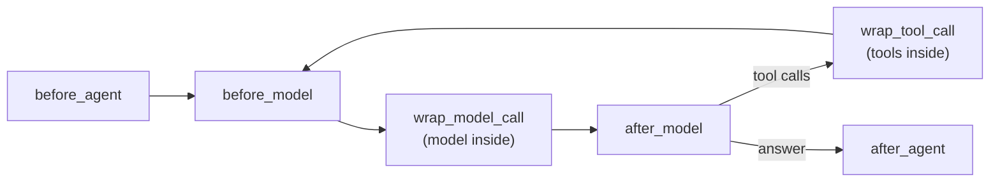
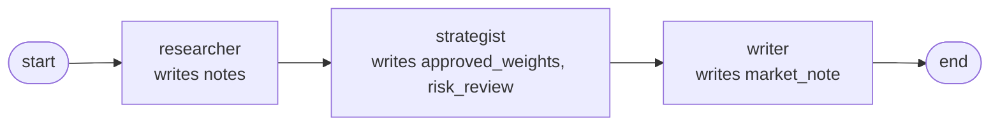

# LangChain Overview

Suppose you want an agentic workflow to build a portfolio from three funds, an Equity Fund, a Bond Fund and a Cash Fund, with at most 40% in equity. You would most likely need three agents and one check:
- a researcher, who measures how each fund has performed and how risky it is;
- a strategist, who turns the researcher's analysis into weights;
- a risk check, a layer of plain code that applies the limits in the mandate;
- a writer, who explains the result in a short market note.

This system could look like this:



LangChain is a framework, built on top of LangGraph, that helps you build agentic systems like this one. It comes with a ready-made set of building blocks that make the job simpler.

The following sections show how.

## What an agent is

This section explains how a large language model (LLM), like the one behind ChatGPT or Claude, differs from an agent. To see it, start with the `researcher` from the example above.

If you open ChatGPT (or Claude) and ask *"how have the Equity, Bond and Cash funds performed over the last three months?"*, you get one answer, written from whatever the model happens to remember. On its own, the model has no access to the funds' prices. What the researcher needs is the ability to *find things out*: ask for the returns, read them, and decide what to look at next.

To do this, the model must be given a set of **tools**, for example a function that fetches prices, and be able to use them repeatedly. A model that works this way is called an **agent**.

In LangChain you build one with `create_agent`, giving it a model, some instructions and a set of tools ([[Agents in LangChain]]).

Inside each agent there is a repeating process called the **loop**. In the example, the loop is the researcher's "ask, read, decide again" cycle. The idea is the same in any framework:
- the model decides what it needs to do its task (your request), and asks for it (in the example above, it asks for the tool that fetches the funds' returns);
- your program carries out what it asked for;
- the model reads the result;
- this repeats until the model answers without asking for anything ([[Introduction#What is a loop|What is a loop]]).

Each round of this loop is a **turn**. Two things happen in a round: your program **calls the model**, and then **runs the tools** the model asked for (if any). So a turn is one model call, plus the tools it requested.

Take the researcher. It's asked to *"Research the funds"*, and it has two tools:
- one that gives the funds' returns over a number of past days (up to 365);
- one that gives the volatility of a fund.

It can't do everything in one go. It must first know the returns before deciding which funds' risk is worth checking. And let's imagine that its very first request turns out to be wrong, so it needs one more round to fix it. That makes **four turns** ([[Introduction#What is a turn|What is a turn]]):

| Turn | The model asks for… | …your program runs it, and the model reads |
|---|---|---|
| 1 | the returns over the last 500 days | an error: at most 365 days. Nothing ran |
| 2 | the returns over the last 90 days | equity +4%, bond +1%, cash +0.5% |
| 3 | the volatility of equity **and** of bond, in one request | equity 15%, bond 5% (cash barely moves, so it skips it) |
| 4 | nothing: it writes its notes | the loop ends |

Each row is one model call followed by the tools it asked for. Turn 3 shows that one turn can run several tools, and turn 4 shows how the loop ends: a reply that asks for nothing is the answer.

In LangChain you never write this loop yourself: `create_agent` runs it, and it helps to know what happens inside, especially how the conversation is resent on every turn and what makes the loop stop ([[The agent loop in LangChain]]).

## Giving the agent abilities: tools and runtime

An LLM only reads and writes text, so it can't look up a fund's returns itself.

To give it these abilities, we **bind** tools to the model. Binding means letting the model know which tools exist. Fundamentally, a tool is a function, like `get_returns` or `get_volatility`, with specific arguments and types, and a description. We write the function and its description carefully, because they are sent to the model with every request: that's how the model knows what the tool is for, what inputs it takes and what it returns.

Earlier we said that the model *asks for* tools. This means that, by reading the request and the tools' descriptions, the model may decide that it needs one of them. But the model doesn't run it: an LLM only reads and writes. Instead, it writes a request for it, for example:

```text
call get_returns with {"days": 90}
```

Then your program runs the requested function with the arguments the model chose, and hands the result back ([[Introduction#What is a tool|What is a tool]]). In LangChain, a tool is an ordinary Python function marked with `@tool`; its name, its docstring and the types of its arguments become the description the model reads.

What happens if the model asks for something impossible? In turn 1 of the example, the researcher asks for the returns over the last 500 days, but the tool only accepts 5 to 365 (a limit we chose for the example). The function doesn't run. Instead, the error goes back to the model as the tool's result:

```text
days: Input should be less than or equal to 365. Please fix the error and try again.
```

The model reads it and, in turn 2, asks again with 90 days ([[Tools in LangChain]]).

Note that the funds were never passed to the tool as an argument. The model asked for `get_returns` with `days=90`, and got back the returns of the Equity, Bond and Cash funds. But it never said *which* funds. So how did the tool know which ones to measure?

Because not everything a tool needs should come from the model. A tool can receive two kinds of input:

|                               | **Arguments**                             | **Runtime context**                 |
| ----------------------------- | ----------------------------------------- | ----------------------------------- |
| **Who sets them**             | the model, in its request                 | your code, when it starts the agent |
| **The model sees them**       | yes: they're in the tool's description    | no                                  |
| **Can change during the run** | yes: the model picks new values each call | no: fixed for the whole run         |
| **In the example**            | `days`: how far back to look              | the funds in the mandate            |

Let the model choose what is part of *its* reasoning and keep out of its hands what is *given* and must not change. If the funds were an argument, the model could get them wrong, leave one out, or add one that isn't in the mandate, and nothing would stop it.

LangChain carries the fixed part in the **runtime** ([[Runtime in LangChain]]).

## Shaping how the agent works and what it returns

Tools say what an agent *can* do; they don't say *how* to do it well.

The researcher can ask for returns and volatility, but nothing tells it *how* to use them: returns first, then the risk of the funds that move. That method is a **skill**: a short file of instructions the agent reads up front, or loads when it needs it ([[Skills in LangChain]]).

Now take the strategist, the second agent. It reads the researcher's notes and decides the portfolio's **weights**: how much of the money goes into each fund. Its answer isn't read by a person: it goes straight to the risk check, a piece of code that verifies equity is at most 40%.

If we simply passed the researcher's notes to the strategist's model, it would most likely answer in free text, like *"mostly equity, some bonds"*. Code can't check that against a 40% limit: it needs a number for every fund. So the strategist is given a **schema**, a description of the exact form its answer must take (a weight for every fund, and a short rationale), and LangChain checks every answer against it.

If an answer fails the check, it isn't passed on: the error goes back to the model, which answers again. In the example, the strategist's first answer gives weights for equity and bond only, and forgets the Cash Fund. The check fails with *"Every fund needs a weight; missing: ['cash']"*, and the second answer, equity 55%, bond 30%, cash 15%, passes ([[Schemas in LangChain]]).

## Putting your own code inside the loop

Let's say that the strategist decides to invest 55% in equity, 30% in bonds and 15% in cash. At first sight everything looks fine, as its answer has the right form: a weight for every fund, as the schema requires.

However, we said before that the mandate allows at most 40% in equity. Why didn't we get any error?

Because a schema checks the *shape* of an answer, whereas here we need a rule about its *content*, one that must hold whatever the model wrote. In other words, we need our own code to check the weights, and fix them if needed.

That's not the only thing that can go wrong during a run:
- **the model never stops**: it keeps calling tools, keeps forgetting an argument, or keeps breaking the schema, turn after turn;
- **the provider fails**: the model's server times out or returns an error in the middle of the run.

Where do we add this code, and when should it run? With `create_agent`, LangChain runs a predefined loop for you, so there's no obvious place to put it. But nothing is lost: LangChain lets you run your own logic at fixed moments of the loop, called **hooks** ([[Hooks in LangChain]]).

These moments are:
- **before the agent starts** (`before_agent`), once: e.g. check the request that is sent to the agent;
- **before each model call** (`before_model`): e.g. count the calls made so far;
- **around each model call** (`wrap_model_call`): e.g. add the mandate to the prompt, or retry a call that failed;
- **after each model reply** (`after_model`): e.g. count the tool calls the model asked for;
- **around each tool call** (`wrap_tool_call`): e.g. refuse a call, or catch a tool's error;
- **after the agent answers** (`after_agent`), once: e.g. check the final answer, like the strategist's weights.



The middle steps repeat on every turn, until the model answers.

Once you have chosen the right moment, you write the logic that runs there. This is done by attaching **middleware** to a hook, and each problem above has its own:

| Problem                           | Middleware                                                                                  | Hook                                     |
| --------------------------------- | ------------------------------------------------------------------------------------------- | ---------------------------------------- |
| equity at 55%, over the 40% limit | the risk check, your own class: caps equity and approves **equity 40%, bond 40%, cash 20%** | after the agent answers                  |
| the model never stops             | ready-made limits on model calls and tool calls (below)                                     | before each model call, after each reply |
| the provider fails                | a ready-made retry: waits, then sends the same call again                                   | around each model call                   |
| the model must know the mandate   | a small function that adds it to the prompt                                                 | around each model call                   |

More on how to write each kind: [[Middleware in LangChain]].

### Limits: making sure the loop ends

Let's say that the researcher is a bit insecure (it behaves like a trainee), and after getting the 90-day returns it isn't satisfied: it asks for 120 days, then 180, then 200, and keeps going.

Let's also say that the strategist isn't very detail-oriented and keeps forgetting the Cash Fund, so every answer fails the schema check, is rejected, and it tries again.

In both cases, each step is reasonable on its own:
- the researcher thinks it needs the tool again, so it asks for it, and your code runs it;
- the strategist's answer fails the schema check, the error goes back to the model with an instruction to fix it, and it tries again.

And in both cases, nothing stops them from repeating, because the only way out of the loop we have seen so far is the model answering.The loop ends only when the model decides it's done, and nothing guarantees it will. 

However, every extra turn resends the whole conversation, so a loop like this gets slower and more expensive. That's why every agent needs **limits**, and each one counts something different:

| Limit                                             | Counts                                                   | When it's reached                                                         | In the example                                                |
| ------------------------------------------------- | -------------------------------------------------------- | ------------------------------------------------------------------------- | ------------------------------------------------------------- |
| **tool call limit** (`ToolCallLimitMiddleware`)   | tool calls, across all turns                             | further tool calls are refused, so the model must answer with what it has | researcher: at most 6 (it uses 4)                             |
| **model call limit** (`ModelCallLimitMiddleware`) | model calls, i.e. turns                                  | the agent stops, **without an answer**                                    | at most 8 per agent (the researcher uses 4, the strategist 2) |
| **recursion limit**                               | internal steps of the agent's graph, middleware included | the run stops with an error                                               | a backstop, set well above the others                         |

So, in the scenario above:
- the researcher asking for more and more returns hits the **tool call limit** after 6 calls: its next requests are refused, and it writes its notes with the data it already has;
- the strategist that keeps failing the schema hits the **model call limit** after 8 turns: it stops with no weights at all, so the next step must handle a missing answer (each rejected answer costs a turn);
- the **recursion limit** never fires here: it's a safety net, for a loop that nothing else has stopped ([[Introduction#What is a turn|What is a turn]], [[Limits in LangChain]]).

## From one agent to a team

So far we have looked at each agent on its own. But the researcher's notes are useless unless the strategist can read them, and the approved weights are useless unless the writer can explain them. To make the agents a team, two more ideas are needed: **state**, to pass results along, and a **workflow**, to decide who runs when.

### State

Let's say that the researcher has just finished its four turns. Along the way it collected a lot: the rejected 500-day request and its error, the 90-day returns, the volatility of equity and bond, and finally its notes. Now it's the strategist's turn. What should it receive? Not all of it: the error and the raw tool results would only clutter its prompt. It needs the notes, and nothing else.

That's the job of the **state**: a dictionary that holds what a run has produced so far. Each step reads the keys it needs and returns only the keys it produced; LangChain merges them in, and a key written again replaces its old value. There are two levels of state, kept apart on purpose:
- **each agent's own state**: its conversation (`messages`, which grows every turn) and its checked answer (`structured_response`, if it has a schema). This is where the researcher's four turns live;
- **the workflow's shared state**: only the results the agents pass to each other. Its keys are declared up front, and a key that isn't declared is silently dropped.

In the example, the shared state fills up step by step:
1. the researcher writes `notes`: *"Equity: +4% over 90 days, volatility 15%. Bond: +1%, volatility 5%. Cash: +0.5%, almost no risk."*;
2. the strategist reads `notes`, and writes `approved_weights` (equity 40%, bond 40%, cash 20%, after the risk check) and `risk_review` (equity was cut from 55%);
3. the writer reads both, and writes `market_note`, which can now explain why equity is at the limit ([[State in LangChain]]).

### Workflow

Something still has to decide the order: the researcher first, the strategist only once the notes exist, the writer last. And it has to hand each agent the right keys from the shared state.

That's the **workflow**. In LangChain it's a LangGraph graph (`StateGraph`) made of:
- **nodes**: the steps. Each one is a Python function that reads the shared state, runs one agent, and returns the keys it produced;
- **edges**: what runs next. Edges can form a straight line, branches, loops or parallel steps.

In the example, the workflow is a straight line with three nodes:



A graph isn't the only way to combine agents. You could also let a main agent call the others as tools, and decide by itself which one to use and when ([[Workflow in LangChain]]).

## Where to go from here

> [!tip] Next read: [[Introduction#LangGraph vs LangChain|LangGraph vs LangChain]]
> Now that you've seen how LangChain builds an agent, compare it with LangGraph, where you write every step of the loop yourself. It helps you choose which library to build with.

Then go deeper into each part, with the detail notes in the order this tour introduced them:
- [[Agents in LangChain]]
- [[The agent loop in LangChain]]
- [[Tools in LangChain]]
- [[Runtime in LangChain]]
- [[Skills in LangChain]]
- [[Schemas in LangChain]]
- [[Hooks in LangChain]]
- [[Middleware in LangChain]]
- [[Limits in LangChain]]
- [[State in LangChain]]
- [[Workflow in LangChain]]

The [[Introduction]] explains the ideas behind them without any library: tools, the loop, turns, and how LangChain and LangGraph differ.

## Related
[[Introduction]]
