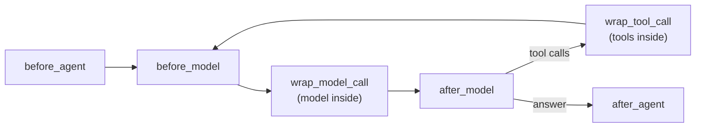

# Hooks in LangChain

> A hook is a named moment in the agent's loop, like "before each model call" or "after the agent answers", where LangChain calls your function.

## What it is

`create_agent` runs the agent loop for you ([[The agent loop in LangChain]]), so there's no place in it for your own `if`. Instead, the loop stops at fixed moments and calls any function you registered for that moment. Those moments are **hooks**. The code you attach to them is middleware ([[Middleware in LangChain]]).

## Its components

There are six hooks, of two kinds:

| Hook | When it runs | Kind |
|---|---|---|
| `before_agent` | once, when the agent starts | node-style |
| `before_model` | before each model call | node-style |
| `wrap_model_call` | around each model call (the call happens inside) | wrap-style |
| `after_model` | after each model reply | node-style |
| `wrap_tool_call` | around each tool call | wrap-style |
| `after_agent` | once, when the agent has its final answer | node-style |



The middle hooks repeat on every [[What is a turn|turn]].

## How LangChain implements it

| | Node-style hooks | Wrap-style hooks |
|---|---|---|
| **Run** | *between* steps | *around* one call |
| **Your function receives** | the agent's state ([[State in LangChain]]) and the runtime ([[Runtime in LangChain]]) | the request (messages, prompt, tools) and a `handler`, the function that makes the call |
| **It returns** | a dict of keys to update, or `None` | the call's result: you decide whether to call `handler` once, again, or not at all |
| **Good for** | reading or updating the state, stopping the run | retrying, changing the request, timing, refusing a call |
| **Decorators** | `@before_agent`, `@before_model`, `@after_model`, `@after_agent` | `@wrap_model_call`, `@wrap_tool_call`, `@dynamic_prompt` (a shortcut that only changes the prompt) |

Two more rules:
- **Stopping early.** A node-style hook can end the run by returning `{"jump_to": "end"}`, if it declares `can_jump_to=["end"]`.
- **Order.** With `middleware=[a, b]`, `before_*` hooks run `a` then `b`, `after_*` hooks run `b` then `a`, and `a`'s wrap hook wraps `b`'s.

```python
import time
from langchain.agents.middleware import before_model, wrap_model_call

@before_model                                    # node-style: reads the state
def log_turn(state, runtime):
    print(f"model call with {len(state['messages'])} messages")
    return None                                  # nothing to change

@wrap_model_call                                 # wrap-style: around the call itself
def timed(request, handler):
    start = time.perf_counter()
    response = handler(request)                  # the real model call
    print(f"model call took {time.perf_counter() - start:.1f} s")
    return response
```

## Example

Take a strategist agent that proposes a portfolio's weights across three funds, under a limit of at most 40% in equity. Its run takes two [[What is a turn|turns]]: its first answer is rejected, its second passes. Here are the hooks it passes through:

| Moment in the run | Hook | What could run there |
|---|---|---|
| the strategist starts | `before_agent` | check the request |
| before turn 1's model call | `before_model` | count the calls made so far |
| around turn 1's model call | `wrap_model_call` | add the mandate to the prompt; retry if the provider fails |
| the model has replied: an answer missing a fund (rejected) | `after_model` | |
| turn 2: the same three hooks again | | |
| the strategist has a valid answer: equity 55% | `after_agent` | the risk check: cap equity at 40% |

## Watch out
- **Every-turn hooks run a lot.** Keep `before_model` and `wrap_model_call` fast.
- **Pick the right kind.** If you need the call itself (retry it, change it), use a wrap-style hook; a node-style hook can't touch the call.

## Related
[[LangChain Overview]] · [[Middleware in LangChain]] · [[The agent loop in LangChain]] · [[State in LangChain]] · [[What is a turn]]

## My notes & questions
