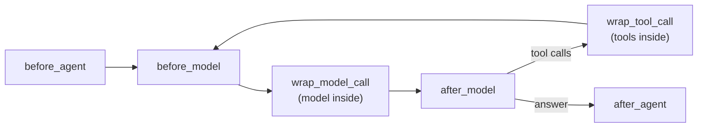

# Hooks in LangChain

> A hook is a named moment in the agent's loop, like "before each model call" or "after the agent answers", where LangChain calls your function.

## Context

`create_agent` runs the loop for you ([[The agent loop in LangChain]]), so there's nowhere to put your own `if`. In [[The running example]] we still need code to run *inside* the strategist's run: after it answers, the risk check must look at the weights. Hooks are the moments where that code can run.

Here is the strategist's run as a timeline, with the hooks it passes through:

| Moment in the run | Hook |
|---|---|
| the strategist starts | `before_agent` |
| just before each model call | `before_model` |
| around each model call (the call happens inside) | `wrap_model_call` |
| the model has replied: turn 1's weights (rejected), then turn 2's | `after_model` |
| around each tool call, if any | `wrap_tool_call` |
| the strategist has its final answer | `after_agent`: **the risk check runs here** |

The middle rows repeat on every [[What is a turn|turn]]: the strategist passes `before_model`, `wrap_model_call` and `after_model` twice.



## Two kinds of hook

**Node-style hooks** (`before_agent`, `before_model`, `after_model`, `after_agent`) run *between* steps. Your function receives the agent's **state** (the messages so far, plus any keys you added) and returns a dict of keys to update, or `None`.

**Wrap-style hooks** (`wrap_model_call`, `wrap_tool_call`) run *around* one call. Your function receives the **request** (messages, prompt, tools) and a `handler`, the function that makes the call. You decide what happens: change the request, call `handler` once, call it again, or not at all.

## Example

```python
import time
from langchain.agents.middleware import before_model, wrap_model_call

@before_model                                    # node-style: reads the state
def log_turn(state, runtime):
    print(f"model call with {len(state['messages'])} messages")
    return None                                  # nothing to change

@wrap_model_call                                 # wrap-style: around the call itself
def timed(request, handler):
    start = time.perf_counter()
    response = handler(request)                  # the real model call
    print(f"model call took {time.perf_counter() - start:.1f} s")
    return response
```

Use a **wrap** hook when you need the call itself (retry it, change the prompt, time it). Use a **node** hook when you only read or update the state.

## Watch out
- **Order.** With `middleware=[a, b]`, `before_*` hooks run `a` then `b`, `after_*` hooks run `b` then `a`, and `a`'s wrap hook wraps `b`'s.
- **Stopping early.** A node hook can end the run by returning `{"jump_to": "end"}`, if it declares `can_jump_to=["end"]`.
- **Every-turn hooks run a lot.** Keep `before_model` and `wrap_model_call` fast.

## Related
[[LangChain Overview]] · [[The running example]] · [[Middleware in LangChain]] · [[The agent loop in LangChain]] · [[State in LangChain]] · [[What is a turn]]

## My notes & questions
