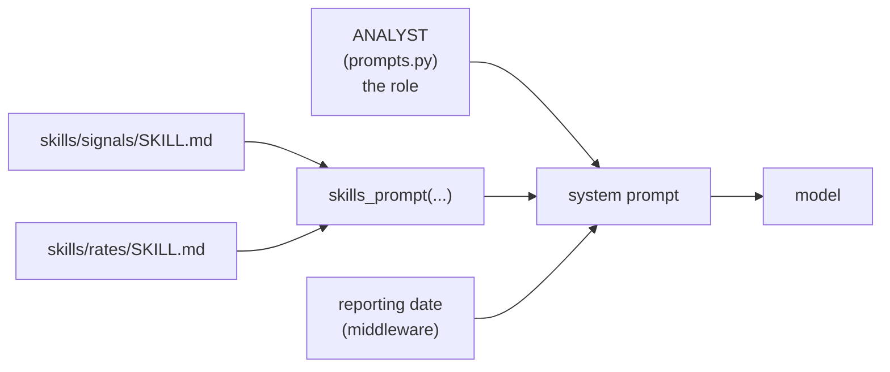

# Skills in LangChain

> A skill is a method written in its own file and added to the agent's system prompt.

## Context

In the [[Agents in LangChain#Context|running example]], the model asks for statistics over **90 days**, then over **365 days**, then gives the signals. Why those two windows? The analyst's role in `prompts.py` only says "Use get_asset_statistics, then submit one signal for every asset". It says nothing about windows.

The method comes from a **skill**: the `signals` skill (`skills/signals/SKILL.md`). It says to use a short and a long window, rank the assets in each, and give **high** only to assets in the top third of both. A second skill, `rates`, explains how to treat `EUROSTR=` and `USDSOFR=`, which are interest rates, not prices.

Both are part of the analyst's **system prompt**, so the model has read them before its first call.

## What a skill is

A skill is just text: instructions written down in a file instead of inside `prompts.py`. When the agent is built, `skills_prompt(...)` reads the files and adds them to the end of the system prompt:



Why a separate file, if it all ends up in the prompt anyway?
- **One method, one place.** The role says *who* the agent is. Each skill says *how* to do one thing, and you can edit it without touching the rest.
- **Reuse.** Several agents can be given the same skill.
- **Easy to try.** Adding or removing a method is one name in a list.

Skills aren't a LangChain feature. They're the template's own small helper (`skills.py`): plain Python that reads files and joins text.

## How to add one

1. **Write the file** `skills/<name>/SKILL.md`: a header (`name:`, `description:`), a line `---`, then the instructions.
   ```markdown
   name: momentum
   description: How to spot assets with strong recent momentum.
   ---
   # Momentum
   1. Call get_asset_statistics with lookback_days = 30 ...
   2. **Add its name** to the agent's prompt in `agents.py`:
   ```python
   # agents.py, analyst
   agent = create_agent(
       llm,
       tools=[get_asset_statistics],
       system_prompt=ANALYST + skills_prompt("signals", "rates", "momentum"),
       ...
   )
   ```

That's all. Here is the system prompt the model now receives on 31 January 2025. You write the role and the skill files, and the rest is assembled for you:

```text
You are a market analyst.                                              ← ANALYST (prompts.py)
Use get_asset_statistics, then submit one signal (high, neutral, or low) for every asset
with a concise rationale. Do not invent data or omit assets.

## Skills (methods to follow)                                          ← skills_prompt(...)

### Skill signals: How to turn asset statistics into high / neutral / low signals.
# From statistics to signals
1. Call `get_asset_statistics` twice: a short window (90) and a long one (365). ...

### Skill rates: How to read the money-market rates (EUROSTR=, USDSOFR=) among the assets.
# Money-market rates
...

### Skill momentum: How to spot assets with strong recent momentum.
# Momentum
1. Call get_asset_statistics with lookback_days = 30 ...

The reporting date is 2025-01-31.                                      ← reporting_date_prompt (middleware)
```

If the skill should be used only in a specific situation, say so in the skill itself ("Use this only for equity indices…"), or in the role in `prompts.py`.

## Watch out
- **Every skill is resent on every model call.** The system prompt goes with every [[What is a turn|turn]], so long or many skills cost tokens and the model's attention. Give an agent only the skills it needs, and keep them short.
- **A skill is advice, not a rule.** The model may follow it loosely. A rule that must always hold belongs in code: a validator ([[Schemas in LangChain]]) or a guardrail ([[Middleware in LangChain]]).
- **Skills mustn't contradict each other or the role.** They all land in one prompt, and the model can't tell which one wins.

## Related
[[Agents in LangChain]] · [[Middleware in LangChain]] · [[What is a turn]]

