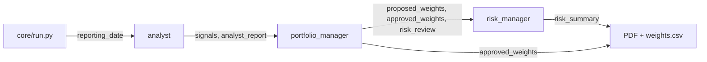

# State in LangChain

> The state is a shared dictionary for one run. Each step reads what it needs from it and writes back what it produced.

## Context

The [[Agents in LangChain#Context|running example]] ends with the analyst's answer: a signal per asset and a reason. Where does that answer go? For the reporting date 31 January 2025, three agents work one after the other ([[Workflow in LangChain]]), and each needs something from the one before:
- the **analyst** needs the date, and produces signals;
- the **portfolio manager** needs the signals, and produces weights;
- the **risk manager** needs the weights, and produces a summary;
- at the end, `core/` needs the approved weights for `weights.csv`, and `report.py` needs everyone's text for the PDF.

The agents don't call each other or pass arguments to each other. They all read from and write to one dictionary, the **state**. Step by step:

1. `core/run.py` starts the run with `{"reporting_date": "2025-01-31"}`.
2. The analyst step reads `reporting_date` and returns `{"signals": {...}, "analyst_report": "..."}`. These keys are **merged** into the state, which now has 3 keys.
3. The portfolio manager step reads `signals` and returns `proposed_weights`, `portfolio_rationale`, `approved_weights` and `risk_review`.
4. The risk manager step reads the weights and returns `risk_summary`.
5. `core/` reads `approved_weights` from the final state, and `report.py` reads the rest.



Each step returns **only the keys it changes**, never the whole dictionary. LangGraph merges them in, and a key written again replaces its old value.

## The workflow's state: `PortfolioState`

Which keys exist is written down in `state.py` as a `TypedDict`: a normal Python dict whose keys and value types are declared. `total=False` means a key can be missing, because at the start only `reporting_date` exists and the others are filled in as the run goes. The comment on each key says who writes it and who reads it, so the file doubles as a map of the system.

```python
class PortfolioState(TypedDict, total=False):
    reporting_date: str                  # run_date (core) -> every node
    signals: dict[str, str]              # analyst -> portfolio_manager, PDF
    approved_weights: dict[str, float]   # portfolio_manager (UsExposureGuardrail) -> risk_manager, PDF, CSV (required)
    ...
```

## Each agent's own state: `AgentState`

Inside each agent there's a **second, separate state**: the one the agent loop uses ([[The agent loop in LangChain]]). It has two keys:
- `messages`: the conversation (request, tool calls, tool results, replies). New messages are *appended*, not replaced;
- `structured_response`: the checked final answer, if the agent has a `response_format`.

The two states are kept apart on purpose. The analyst's conversation can be long, with every statistics table it fetched, and the portfolio manager doesn't need any of that. So the node copies out only the result:

```python
result = agent.invoke(...)                          # result = the agent's final AgentState
analysis = result["structured_response"]
return {"signals": analysis.signals, "analyst_report": analysis.rationale}   # into PortfolioState
```

## Adding keys to an agent's state: `RiskState`

The portfolio manager has a **guardrail**: middleware that, after the agent answers, checks the US exposure and rebalances the weights if needed ([[Middleware in LangChain]]). The guardrail must store its result somewhere, but `AgentState` only has `messages` and `structured_response`.

The template solves this in three steps:
1. **Declare the new keys.** `RiskState` is `AgentState` plus `approved_weights` and `risk_review`. `NotRequired` means they may be missing (for example if the agent gave no answer).
2. **Attach them to the middleware.** `state_schema = RiskState` in `UsExposureGuardrail` tells `create_agent` to add these keys to the agent's state.
3. **Write, then copy out.** The guardrail's `after_agent` hook ([[Hooks in LangChain]]) returns `{"approved_weights": ..., "risk_review": ...}`, and the node copies both into `PortfolioState`.

```python
class RiskState(AgentState):
    approved_weights: NotRequired[dict[str, float]]
    risk_review: NotRequired[dict[str, Any]]

class UsExposureGuardrail(AgentMiddleware[RiskState]):
    state_schema = RiskState
```

## Watch out
- **`approved_weights` is required.** `core/` writes it to `weights.csv`. `report.py` reads the other keys for the PDF, so don't rename them without updating the report.
- **New key = declare it first.** For the workflow, add it to `PortfolioState`. For an agent, add it through a middleware's `state_schema`. A key that isn't declared is **silently dropped**, with no error: the step returns it, and the next step just doesn't find it.

## Related
[[Agents in LangChain]] · [[Workflow in LangChain]] · [[Middleware in LangChain]] · [[Hooks in LangChain]] · [[The agent loop in LangChain]]

