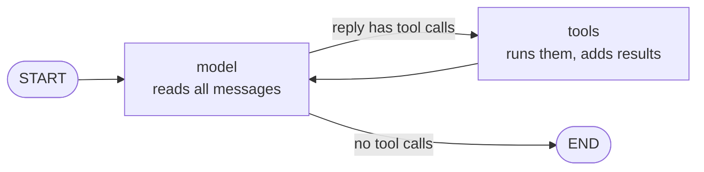

# The agent loop in LangChain

> Inside `create_agent` there are just two steps (**langchain steps**), **model** and **tools**, repeated until the model stops asking for tools. Everything else is added around them.

## Context

The [[Agents in LangChain#Context|running example]] lists six steps (**example steps**). Seen from inside the agent, they're **three [[What is a turn|turns]]** of the same **langchain steps** loop, and one list, `messages`, that grows each turn:

| Turn | model step: the LLM reads all `messages` and replies | tools step: run the calls, add the results | `messages` now holds |
|---|---|---|---|
| 1 | "call `get_asset_statistics` with 90 days" | the 90-day statistics | prompt (role + [[Skills in LangChain\|skills]]), request, call, table |
| 2 | "call it again with 365 days" | the 365-day statistics | … + call, table |
| 3 | "call `Analysis(signals=..., rationale=...)`": the answer | nothing to run: the loop ends | … + the answer |

On every turn, the model receives **the whole list** of messages: its earlier calls (history) and all their results. That's how, at turn 3, it can compare the 90-day and 365-day numbers it asked for at turns 1 and 2. The model itself remembers nothing between calls. The list is its memory.

## The two steps

1. **model**: send all of `messages` to the LLM, together with the tool descriptions. Add its reply to the list.
2. **tools**: if the reply contains tool calls, run each one and add its result as a `ToolMessage` (the message type for a tool's result). Then go back to step 1.



The same loop written by hand *(simplified: this isn't template code, it's roughly what `create_agent` does for you)*:

```python
from langchain_core.messages import HumanMessage, SystemMessage, ToolMessage

tools = {t.name: t for t in [get_asset_statistics]}
model = llm.bind_tools(list(tools.values()))        # the model gets the tool descriptions

messages = [SystemMessage(ANALYST + skills_prompt("signals", "rates")), HumanMessage("Analyse the assets.")]
for turn in range(MAX_MODEL_CALLS):                  # a limit, so the loop always ends
    # 1. model step: send ALL the messages, add the reply
    reply = model.invoke(messages)
    messages.append(reply)
    if not reply.tool_calls:                          # no tool calls: this reply is the answer
        break
    # 2. tools step: run each call, add its result tagged with the call's id
    for call in reply.tool_calls:                     # e.g. {"name": "get_asset_statistics",
        tool = tools[call["name"]]                    #       "args": {"lookback_days": 90}, "id": "call_1"}
        result = tool.invoke(call["args"])
        messages.append(ToolMessage(content=str(result), tool_call_id=call["id"]))

answer = messages[-1].content
```

The two numbered comments are the two steps, and the `for` loop is the arrow from `tools` back to `model`. The rest is what `create_agent` adds on top:
- it fills in the hidden `runtime` (the reporting date) when it runs a tool;
- it checks the arguments against the tool's schema, and sends errors back to the model;
- it turns the final answer into a checked object (`structured_response`);
- it runs your middleware at each [[Hooks in LangChain|hook]].

The LangGraph system writes this same loop as two graph nodes, `analyst` and `tools` ([[Tools in LangGraph]]).

## How the loop ends

| What happens | Why it stops | In the template |
|---|---|---|
| The model replies **without tool calls** | it has nothing more to ask; the text is the answer | the `risk_manager`'s explanation |
| The model calls the **answer schema** | with `ToolStrategy`, the answer is a tool call; it's checked and stored in `structured_response` | turn 3 above |
| A **hook** ends it | middleware decides to stop | `call_limit()` after `MAX_MODEL_CALLS` |
| The **recursion limit** is hit | too many graph steps: an error | `AGENT_RECURSION_LIMIT = 100` |

Two things **don't** end it:
- An **invalid answer** (say, "very strong" instead of high, neutral or low). With `handle_errors=True`, the error goes back to the model as a message, and turn 3 is simply repeated ([[Schemas in LangChain]]).
- **Too many tool calls.** After `MAX_TOOL_CALLS`, `tool_call_limit()` refuses further calls with an error message, so the model has to answer with what it has.

## Where middleware fits

Around these two steps there are fixed moments where your code can run: before the agent, before, around and after each model call, around each tool call, and after the agent. These are [[Hooks in LangChain|hooks]], and each one is an extra step in the loop. That's why one turn takes several internal steps, and why `AGENT_RECURSION_LIMIT` (100) sits far above `MAX_MODEL_CALLS` (8).

## Watch out
- **The list grows every turn.** Every model call resends all of it, so many calls with big results get slow and costly. Keep tool outputs small.
- **The loop is invisible from outside.** The workflow only sees the final state ([[Workflow in LangChain]]). To see each turn, open the run in Langfuse.

## Related
[[Agents in LangChain]] · [[What is a turn]] · [[What is a tool]] · [[Hooks in LangChain]] · [[Tools in LangChain]] · [[Middleware in LangChain]] · [[Tools in LangGraph]]


