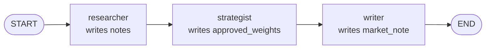

# Workflow in LangChain

> The workflow decides who runs when. With several agents, it's a small LangGraph graph: one node per step, and edges for the order.

## What it is

`create_agent` builds one agent. When several agents work together, something has to decide the order (who runs first, who waits for whose result) and hand each one what it needs. That's the **workflow**.

## Its components

| Component | What it is |
|---|---|
| **state** | the shared dictionary the steps read and write ([[State in LangChain]]) |
| **nodes** | the steps: Python functions that read the state, do one job (often: run one agent), and return the keys they produced |
| **edges** | what runs next: a straight line, branches, loops or parallel steps |
| **start and end** | where the run enters the graph, and where it leaves |

## How LangChain implements it

LangChain uses a LangGraph **graph** (`StateGraph`), built in three moves:

| Call | What it does |
|---|---|
| `StateGraph(State)` | creates the graph, and says which state the nodes share |
| `add_node("name", function)` | adds a step |
| `add_edge(a, b)` | says `b` runs after `a`; `START` and `END` mark the entry and exit |
| `compile()` | turns the description into something you can run |
| `workflow.invoke({...})` | runs it with an initial state, and returns the final state |

A graph isn't the only way to combine agents:

| Pattern | How | When |
|---|---|---|
| **Custom workflow** (a graph) | your graph decides the order | the steps are known in advance |
| **Subagents** | a main agent calls other agents as tools, and decides which one to use | the order depends on the request |
| **Router** | one step classifies the request and sends it to the right agent (or several) | requests of a few clear kinds |

## Example

Take three agents that build a portfolio from three funds (equity, bond and cash), one after the other: a researcher, a strategist (with its risk check), and a writer.



```python
from langgraph.graph import StateGraph, START, END

graph = StateGraph(PortfolioState)
graph.add_node("researcher", research_step)     # each step calls one agent
graph.add_node("strategist", strategy_step)
graph.add_node("writer", write_step)
graph.add_edge(START, "researcher")
graph.add_edge("researcher", "strategist")
graph.add_edge("strategist", "writer")
graph.add_edge("writer", END)
workflow = graph.compile()

final = workflow.invoke({"mandate": Mandate(funds=("equity", "bond", "cash"), max_equity=0.40)})
final["approved_weights"]                        # {"equity": 0.40, "bond": 0.40, "cash": 0.20}
```

Each node is a small function: it builds its agent's request from the state, runs the agent, and returns the keys it produced (`research_step` is shown in [[State in LangChain]]). For branches, loops or parallel steps, see [[LangChain or LangGraph]].

## Watch out
- **The steps can't see each other's conversations**, only the state. If the writer must explain why equity was cut, the strategist's step must put it in the state (`risk_review`).
- **To add an agent:** write its step function (state in, keys out), declare its keys in the state, `add_node` it, and wire it with edges.

## Related
[[LangChain Overview]] · [[State in LangChain]] · [[Agents in LangChain]] · [[Middleware in LangChain]] · [[LangChain or LangGraph]]

## My notes & questions
