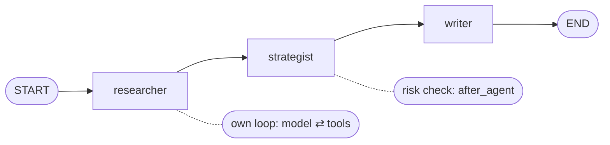

# Workflow in LangChain

> The workflow decides the order of the steps. Here it's three agents in a line, each one a step of a small LangGraph graph.

## Context

In [[The running example]], three agents work one after the other: the researcher, then the strategist (with its risk check), then the writer. Something has to say *"first the researcher, then the strategist, then the writer"*, and pass each one's result to the next. That's the **workflow**.



## Building it

`create_agent` builds one agent. To chain several, LangChain uses a LangGraph **graph** (`StateGraph`): a set of **nodes** (steps, i.e. Python functions) joined by **edges** (what runs next). Three moves:

1. `StateGraph(PortfolioState)`: create the graph, and say which dictionary the nodes share ([[State in LangChain]]).
2. `add_node` for each step, `add_edge` for the order.
3. `compile()`: turn the description into something you can run.

## Example

```python
from langgraph.graph import StateGraph, START, END

graph = StateGraph(PortfolioState)
graph.add_node("researcher", research_step)     # each step calls one agent
graph.add_node("strategist", strategy_step)
graph.add_node("writer", write_step)
graph.add_edge(START, "researcher")
graph.add_edge("researcher", "strategist")
graph.add_edge("strategist", "writer")
graph.add_edge("writer", END)
workflow = graph.compile()

final = workflow.invoke({"mandate": Mandate(funds=("equity", "bond", "cash"), max_equity=0.40)})
final["approved_weights"]                        # {"equity": 0.40, "bond": 0.40, "cash": 0.20}
```

Each node is a small function: it builds the agent's request from the state, runs the agent, and returns the keys it produced (`research_step` in [[State in LangChain]]).

## Other ways to combine agents

| Pattern | How | When |
|---|---|---|
| **Custom workflow** (this note) | your graph decides the order | the steps are known in advance |
| **Subagents** | a main agent calls other agents as tools, and decides which one to use | the order depends on the request |
| **Router** | one step classifies the request and sends it to the right agent (or several) | requests of a few clear kinds |

A graph can also branch, loop or run steps in parallel. That's where LangGraph's own notes take over ([[LangChain or LangGraph]]).

## Watch out
- **The steps can't see each other's conversations**, only the state. If the writer must explain why equity was cut, the strategist's step must put it in the state (`risk_review`).
- **To add an agent:** write its step function (state in, keys out), declare its keys in the state, `add_node` it, and wire it with edges.

## Related
[[LangChain Overview]] · [[The running example]] · [[State in LangChain]] · [[Agents in LangChain]] · [[Middleware in LangChain]] · [[LangChain or LangGraph]]

## My notes & questions
