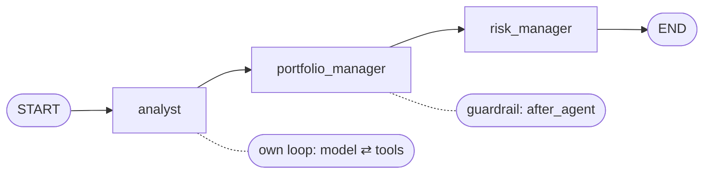

# Workflow in LangChain

> The workflow decides the order of the steps. Here it's three agents in a line, each one a step (node) of a small LangGraph graph.

## Context

The [[Agents in LangChain#Context|running example]] ends at step 6, with the analyst's signals for 31 January 2025. But signals alone aren't a portfolio. For that date, the whole system runs three agents, one after the other ([[The hackathon task]]):

1. the **analyst** turns prices into signals (the example);
2. the **portfolio manager** turns the signals into weights; its guardrail then caps US assets at 20%;
3. the **risk manager** explains the result in plain text.

Something has to say "first the analyst, then the portfolio manager, then the risk manager", and pass each one's result to the next. That's the **workflow**.



## Building it

Even the "LangChain" system uses a LangGraph **graph** (`StateGraph`) for this: a set of **nodes** (steps, i.e. Python functions) joined by **edges** (what runs next). Building one takes three moves:

1. `StateGraph(PortfolioState)`: create the graph, and say which shared dictionary the nodes read and write ([[State in LangChain]]).
2. `add_node` for each step, and `add_edge` for the order.
3. `compile()`: turn the description into something you can run.

```python
# workflow.py
graph = StateGraph(PortfolioState)
graph.add_node("analyst", partial(analyst, llm=llm))      # partial: fix the llm argument
graph.add_node("portfolio_manager", partial(portfolio_manager, llm=llm))
graph.add_node("risk_manager", partial(risk_manager, llm=llm))
graph.add_edge(START, "analyst")
graph.add_edge("analyst", "portfolio_manager")
graph.add_edge("portfolio_manager", "risk_manager")
graph.add_edge("risk_manager", END)
return graph.compile().with_config(recursion_limit=RECURSION_LIMIT)
```

`core/run.py` then runs it once per reporting date: `workflow.invoke({"reporting_date": "2025-01-31"})`. It gets back the final state, with the weights and all the text for the PDF.


## Watch out
- **You can mix the styles.** A `create_agent` agent can be one node of a bigger hand-written graph with branches or parallel steps. The two systems are examples, not a choice.
- **`core/` is fixed.** Don't modify `core/run.py`. Your workflow must accept `{"reporting_date": ...}` and end with `approved_weights` in the state.
- **To add an agent:** write its node function (state in, keys out), `add_node` it, and wire it in with edges.

## Related
[[Agents in LangChain]] · [[State in LangChain]] · [[Middleware in LangChain]] · [[Tools in LangGraph]]


