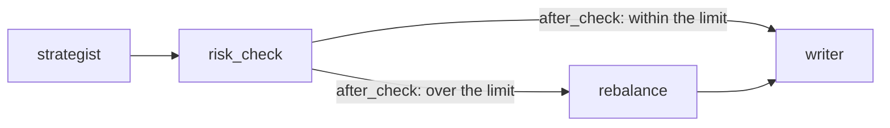

# Branches in LangGraph

> A branch is a fork in the graph: a small function, the **router**, reads the state and returns the name of the node to run next.

## What it is

Some steps should run only sometimes: fix an answer only if it breaks a rule, ask a human only if something looks wrong. A **branch** makes that decision at run time. The graph is drawn with every possible route, and each run takes the one the router picks. The agent loop is a branch too: after each model call, go to the tools, or move on ([[The agent loop in LangGraph]]).

## Its components

- **The node before**: does the work and writes its result to the state, e.g. a check that records whether a rule holds.
- **The router**: a plain function that reads the state and returns the name of the next node. It decides; it doesn't change anything.
- **The destinations**: the nodes the router may choose. Each route can rejoin the others later.

## How LangGraph implements it

- **The router**: `def router(state) -> Literal["a", "b"]`. The `Literal` return type names the possible destinations.
- **The conditional edge**: `graph.add_conditional_edges("node_before", router, ["a", "b"])`. After `node_before` runs, LangGraph calls `router` and goes where it says. The list of destinations lets LangGraph check the graph and draw it.
- **Mapping names**: pass a dict instead of a list, e.g. `{"tools": "tools", END: "strategist"}`, when the router returns names that aren't your nodes'. That's how the prebuilt `tools_condition` is plugged in.
- **Rejoining**: plain edges from each destination to the same next node.

In LangChain, the same kind of check runs as middleware, after the agent answers ([[Middleware in LangChain]]). Here it's a node and a branch you can see in the graph.

## Example

Take a portfolio of three funds (equity, bond and cash), with at most 40% in equity. A strategist proposes equity 55%, bond 30%, cash 15%. A `risk_check` node, plain Python, records whether equity is within the limit, and a router decides what runs next:

```python
from typing import Literal

def risk_check(state: PortfolioState, runtime: Runtime[Mandate]) -> dict:
    weights = state["proposed_weights"]
    total = sum(weights.values())
    weights = {f: w / total for f, w in weights.items()}                  # make them sum to 1
    within = weights["equity"] <= runtime.context.max_equity
    return {"approved_weights": weights, "risk_review": {"within_limit": within, "equity_proposed": weights["equity"]}}

def after_check(state: PortfolioState) -> Literal["writer", "rebalance"]:  # the router: it only reads
    return "writer" if state["risk_review"]["within_limit"] else "rebalance"

graph.add_conditional_edges("risk_check", after_check, ["writer", "rebalance"])
graph.add_edge("rebalance", "writer")                                      # the routes rejoin
```



Equity is at 55%, over the limit, so the run goes through `rebalance`, which caps equity at 40% and scales the others up: **equity 40%, bond 40%, cash 20%**. With weights already within the limit, the same graph would go straight to the writer. In a tracing tool, `rebalance` shows up only in the runs where it was needed.

## Watch out
- **Return a name the edge knows.** If the router returns a node that isn't among the destinations, the run fails.
- **Routers shouldn't change the state.** They only read it: put the work in the node before.

## Related
[[LangGraph Overview]] · [[Workflow in LangGraph]] · [[The agent loop in LangGraph]] · [[State in LangGraph]] · [[Middleware in LangChain]]

## My notes & questions
