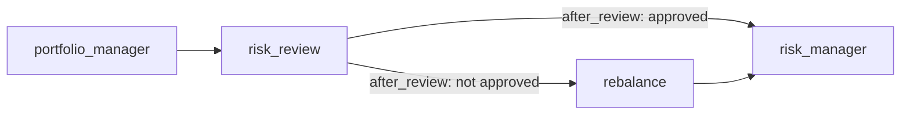

# Branches in LangGraph

> A branch is a fork in the graph: a small function, the **router**, reads the state and returns the name of the node to run next.

## Context

On 31 January 2025, `portfolio_manager` proposes weights with 25% in US assets. `risk_review` checks them against the 20% limit and records `approved: False`. What runs next depends on that result:
- **approved**: go straight to `risk_manager`;
- **not approved** (our date): go to `rebalance` first, which scales the US assets down to 20%, then to `risk_manager`.

On another date, with US at 15%, the same graph skips `rebalance`. One graph, two possible routes, decided at run time.



## Router + conditional edge

A **router** is a plain function: state in, name of the next node out.

```python
# steps.py
def after_review(state) -> Literal["risk_manager", "rebalance"]:
    return "risk_manager" if state["risk_review"]["approved"] else "rebalance"
```

A **conditional edge** attaches the router to a node: after `risk_review`, call `after_review` and go where it says.

```python
# workflow.py
graph.add_conditional_edges("risk_review", after_review, ["risk_manager", "rebalance"])
graph.add_edge("rebalance", "risk_manager")
```

The list `["risk_manager", "rebalance"]` names the possible destinations, so LangGraph can check the graph and draw it.


## Compared with LangChain

The LangChain system has no branch: the same check runs as middleware after the portfolio manager answers ([[Middleware in LangChain]]). Here the decision is visible in the graph, and in Langfuse you see `rebalance` only on the dates where it ran.

## Watch out
- **Return a name the edge knows.** If the router returns a node name that isn't among the destinations, the run fails.
- **Routers shouldn't change the state.** They only read it. Put the work in a node before the router.

## Related
[[Workflow in LangGraph]] · [[The agent loop in LangGraph]] · [[State in LangGraph]] · [[Middleware in LangChain]]


