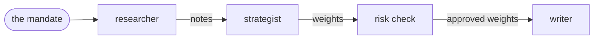
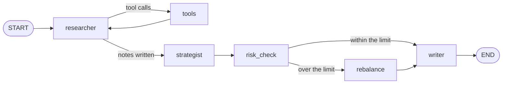
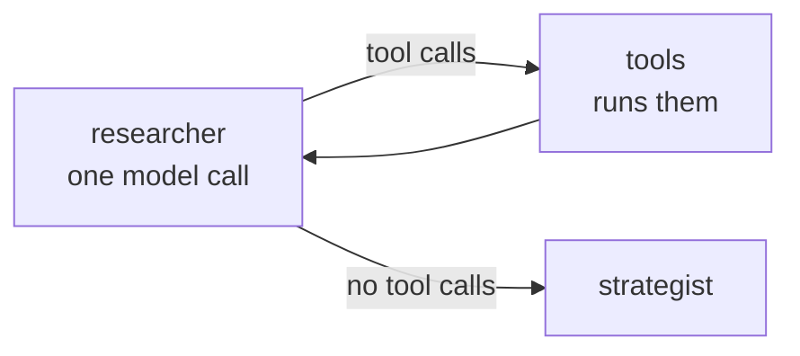
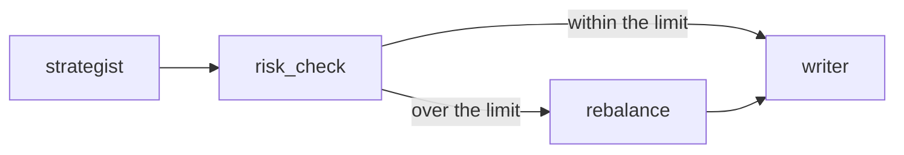

# LangGraph Overview

Suppose you want an agentic workflow to build a portfolio from three funds, an Equity Fund, a Bond Fund and a Cash Fund, with at most 40% in equity. You would most likely need three agents and one check:
- a researcher, who measures how each fund has performed and how risky it is;
- a strategist, who turns the researcher's analysis into weights;
- a risk check, a layer of plain code that applies the limits in the mandate;
- a writer, who explains the result in a short market note.

This system could look like this:



LangGraph is a library for building systems like this one as a **graph**: you write every step as a plain Python function, and you draw how the steps connect. It gives you no ready-made agent but in exchange, you control every step.

The following sections build the system above, one piece at a time.

## The state: what the steps share

Before drawing any step, think about what the steps must hand to each other. The researcher's notes are useless unless the strategist can read them, and the approved weights are useless unless the writer can explain them.

That's the job of the **state**: a dictionary that holds everything the run has produced so far. It starts with the run's input, and as the run goes on, every step reads what it needs from it and adds what it produced. Think of it as a shared whiteboard: steps never talk to each other directly, they only read from and write on the board.

In our system, the state has one key for each result that is handed on, and it fills up as the run goes:
1. `messages`: the researcher's conversation with its tools. Each turn *adds* its messages to the list, instead of replacing it, so the conversation grows;
2. `notes`: the researcher's last reply, its findings for the strategist: *"Equity: +4% over 90 days, volatility 15%. Bond: +1%, volatility 5%. Cash: +0.5%, almost no risk."*;
3. `proposed_weights`: the strategist reads `notes` and writes its answer here, for the risk check;
4. `approved_weights` and `risk_review`: the risk check's result, for the writer. If equity is over the limit, a rebalance step writes a new `approved_weights`, which replaces the old one;
5. `market_note`: the writer reads the two keys above and writes its note, the final result ([[State in LangGraph]]).


## The system as a graph

We now have the board, but nothing yet says who writes on it, and when. The strategist must not start before the researcher's notes exist; the writer must wait for the approved weights; and the rebalance step should run only when equity is over the limit, not on every run. The researcher, meanwhile, must go back and forth with its tools until it's done.

So the system needs an order, with some steps in a line, one that runs only sometimes, and one that repeats. In LangGraph, you write that order as a **graph** built around the state, made of two things:
- **nodes**: the steps. Each one is a Python function: it receives the current state and returns the keys it produced. The researcher is a node, and so is the risk check;
- **edges**: what runs next. A plain edge always goes from one node to the same next one; a **conditional edge** asks a small function where to go, so the graph can branch or loop.

In code, the graph is a **`StateGraph`**: LangGraph's class for a graph whose nodes share a state. That's why you create it from the state's shape, then build it up piece by piece:
1. **create it**: `graph = StateGraph(PortfolioState)`;
2. **add the nodes**: `graph.add_node("researcher", researcher)`, one for each step;
3. **add the edges**: `graph.add_edge("strategist", "risk_check")`, or a conditional edge for a branch or a loop;
4. **compile it**: `workflow = graph.compile()`. This checks the graph (for example, that no edge points to a missing node) and returns something you can run with `workflow.invoke(...)`.

A `StateGraph` is only the drawing: nothing runs until you compile and invoke it. Our system ends up with six nodes ([[Workflow in LangGraph]]):



## An agent you write yourself

This section explains how a large language model (LLM), like the one behind ChatGPT or Claude, differs from an agent, and how you build one in LangGraph.

On its own, a model only answers once, from what it happens to remember: it has no access to the funds' prices. The researcher needs to *find things out*: ask for the returns, read them, and decide what to look at next. So the model is given **tools**, functions it can ask your program to run, and it works in a **loop**: it asks, reads the result, and decides again, until it answers without asking for anything ([[What is a loop]]). A model used this way is an **agent**.

In LangGraph, an agent is a node you write yourself. The node reads what it needs from the state, builds the messages for the model, calls it, and returns the reply as state keys ([[Agents in LangGraph]]).

### The loop, drawn

The agent's loop, *ask for something, read the result, decide again*, runs in rounds, and each round is a **turn**. Two things happen in a round: your program **calls the model**, and then **runs the tools** the model asked for (if any). So a turn is one model call, plus the tools it requested.

Take the researcher. It's asked to *"Research the funds"*, and it has two tools:
- one that gives the funds' returns over a number of past days (up to 365);
- one that gives the volatility of a fund.

It can't do everything in one go. It must first know the returns before deciding which funds' risk is worth checking. And let's imagine that its very first request turns out to be wrong, so it needs one more round to fix it. That makes **four turns** ([[What is a turn]]):

| Turn | The model asks for… | …your program runs it, and the model reads |
|---|---|---|
| 1 | the returns over the last 500 days | an error: at most 365 days. Nothing ran |
| 2 | the returns over the last 90 days | equity +4%, bond +1%, cash +0.5% |
| 3 | the volatility of equity **and** of bond, in one request | equity 15%, bond 5% (cash barely moves, so it skips it) |
| 4 | nothing: it writes its notes | the loop ends |

Each row is one model call followed by the tools it asked for. Turn 3 shows that one turn can run several tools, and turn 4 shows how the loop ends: a reply that asks for nothing is the answer.

In LangGraph, you draw this loop by yourself, with two nodes and two edges:
- the `researcher` node calls the model once per turn;
- a `tools` node runs the tools the model asked for;
- after the researcher, a conditional edge, `tools_condition`, looks at its reply: if it asks for tools, go to `tools`; if not, the loop is over, go to the strategist;
- after `tools`, a plain edge goes back to the researcher.



So the four turns are seven node runs, or **graph steps**. And because the loop is in the graph, you can change it: stop on your own condition, or add a node in the middle ([[The agent loop in LangGraph]]).

### Giving the agent abilities: tools and runtime

In the table above, the researcher "asks for" the returns and the volatility. But an LLM only reads and writes text, so it can't look up a fund's returns itself. How does it ask, and who answers?

First, the model must know which tools exist. Fundamentally, a tool is a function, like `get_returns` or `get_volatility`, with specific arguments and types, and a description. We write the function and its description carefully, because they are sent to the model with every request: that's how the model knows what the tool is for, what inputs it takes and what it returns. Letting the model know about a tool is called **binding** it, and in LangGraph you do it inside the researcher's node, with `model.bind_tools([get_returns, get_volatility])`.

Take `get_returns`. You write it as a normal Python function, marked with `@tool`, with an input schema that limits `days` to 5–365:

```python
class ReturnsInput(BaseModel):
    days: int = Field(ge=5, le=365, description="How many past days to measure, from 5 to 365")

@tool(args_schema=ReturnsInput)
def get_returns(days: int, runtime: ToolRuntime[Mandate]) -> dict:
    """Total return of every fund in the mandate over the last `days` days, in %."""
    ...
```

The model never sees this code. When you bind the tool, it's turned into a description, sent to the model next to the messages on every call:

```json
{
  "name": "get_returns",
  "description": "Total return of every fund in the mandate over the last `days` days, in %.",
  "parameters": {
    "type": "object",
    "properties": {
      "days": {"type": "integer", "minimum": 5, "maximum": 365,
               "description": "How many past days to measure, from 5 to 365"}
    },
    "required": ["days"]
  }
}
```

Each part of the function has its place:
- the function's **name** becomes the tool's name, the one the model writes when it asks for it;
- the **docstring** becomes the description: it's all the model knows about what the tool does, so write it for the model;
- the **arguments**, with their types, limits and descriptions, become the `parameters`: what the model must fill in;
- the `runtime` argument is **missing**: it's hidden from the model, and you'll see why below.

By reading the request and the tools' descriptions, the model may decide that it needs one of them. But it doesn't run it: it writes a request for it, for example:

```text
call get_returns with {"days": 90}
```

Then something must run the requested function with the arguments the model chose, and hand the result back ([[What is a tool]]). In LangGraph, that's the `tools` node of the loop above: a ready-made **`ToolNode`**, given the same tools, which runs every call in the model's last reply and adds each result to the conversation. So each tool is listed twice, once where the model is called and once in the graph:

```python
reply = model.bind_tools([get_returns, get_volatility]).invoke(messages)   # in the researcher node: the model may ask
graph.add_node("tools", ToolNode([get_returns, get_volatility]))           # in the graph: the requests are run
```

What happens if the model asks for something impossible? In turn 1 of the example, the researcher asks for the returns over the last 500 days, but the tool only accepts 5 to 365 (a limit we chose for the example). The function doesn't run, and the `ToolNode` doesn't crash either. Instead, it sends the error back to the model as the tool's result:

```text
days: Input should be less than or equal to 365 … Please fix the error and try again.
```

The model reads it and, in turn 2, asks again with 90 days ([[Tools in LangGraph]]).

Note that the funds were never passed to the tool as an argument. The model asked for `get_returns` with `days=90`, and got back the returns of the Equity, Bond and Cash funds. But it never said *which* funds. So how did the tool know which ones to measure?

Because not everything a tool needs should come from the model. A tool can receive two kinds of input:

|                               | **Arguments**                             | **Runtime context**               |
| ----------------------------- | ----------------------------------------- | --------------------------------- |
| **Who sets them**             | the model, in its request                 | your code, when it starts the run |
| **The model sees them**       | yes: they're in the tool's description    | no                                |
| **Can change during the run** | yes: the model picks new values each call | no: fixed for the whole run       |
| **In the example**            | `days`: how far back to look              | the funds in the mandate          |

Let the model choose what is part of *its* reasoning and keep out of its hands what is *given* and must not change. If the funds were an argument, the model could get them wrong, leave one out, or add one that isn't in the mandate, and nothing would stop it.

LangGraph carries the fixed part in the **runtime**. You pass the mandate once, when you start the run, with `workflow.invoke(..., context=...)`. The tool reads it from a hidden `runtime` argument that the `ToolNode` fills in, and that the model never sees. Nodes can read it too: the researcher puts the funds in its prompt, and the risk check takes its 40% limit from it ([[Runtime in LangGraph]]).

## Getting an answer in a fixed form: the strategist

Now take the strategist, the second agent. It reads the researcher's notes and decides the portfolio's **weights**: how much of the money goes into each fund. Its answer isn't read by a person: it goes straight to the risk check, a piece of code that verifies equity is at most 40%.

If we simply passed the notes to the strategist's model, it would most likely answer in free text, like *"mostly equity, some bonds"*. Code can't check that against a 40% limit: it needs a number for every fund. So the strategist is given a **schema**: a description of the exact form its answer must take. In Python it's a Pydantic class, with a weight for every fund and a short rationale, plus a rule that no fund may be missing:

```python
class Allocation(BaseModel):
    """How much of the portfolio goes into each fund, and why."""
    weights: dict[Literal["equity", "bond", "cash"], float] = Field(description="A weight between 0 and 1 for every fund")
    rationale: str

    @field_validator("weights")
    @classmethod
    def _every_fund(cls, weights):
        missing = sorted({"equity", "bond", "cash"} - set(weights))
        if missing:
            raise ValueError(f"Every fund needs a weight; missing: {missing}")
        return weights
```

A schema does two jobs: 
- it **tells** the model what to write
- it **checks** what the model wrote

But how do you make the model use it, instead of answering in free text?

With the same trick as the tools. The schema is bound to the model as if it were a tool: its name, docstring and fields become a description, like the one for `get_returns` above. The difference is that the model **must** call it (`tool_choice="any"`), and that nothing runs behind it: the arguments the model writes *are* its answer. So the model can only reply by filling in the schema's fields.

The node reads the model's answer, checks it against the given schema, and if the check fails, sends the error back to the model and asks again.

In the example, this is how it goes:
1. the strategist's first answer gives weights for equity and bond only, and forgets the Cash Fund;
2. the check fails with *"Every fund needs a weight; missing: ['cash']"*, and the node sends this error back to the model;
3. the second answer, equity 55%, bond 30%, cash 15%, passes, and the node writes it into the state as `proposed_weights`.

Both attempts happen inside one run of the strategist's node, so they are a single graph step ([[Schemas in LangGraph]]).

## Checking the answer: a branch

Let's say that the strategist decides to invest 55% in equity, 30% in bonds and 15% in cash. At first sight everything looks fine, as its answer has the right form: a weight for every fund, as the schema requires.

However, the mandate allows at most 40% in equity. Why didn't we get any error?

Because a schema checks the *shape* of an answer, whereas here we need a rule about its *content*, one that must hold whatever the model wrote. In other words, we need our own code to check the weights, and fix them if needed.

And what should happen next depends on the result of that check:
- if equity is **within** the limit, the weights are fine, and the writer can explain them right away;
- if equity is **over** the limit, the weights must be fixed first, and only then explained.

So the system needs two things: a step that checks, and a fork after it that picks the next step.

**The check is a node with no model in it.** The `risk_check` node is plain Python. It reads `proposed_weights` from the state, makes sure they add up to 100%, compares equity with the 40% limit from the mandate, and writes the result in the state: `approved_weights`, and `risk_review`, which records whether equity was within the limit.

**The fork is a branch.** A **branch** is a conditional edge after a node: instead of always going to the same next node, it calls a small function, the **router**, which reads the state and returns the *name* of the node to run next:

```python
def after_check(state: PortfolioState) -> Literal["writer", "rebalance"]:
    return "writer" if state["risk_review"]["within_limit"] else "rebalance"

graph.add_conditional_edges("risk_check", after_check, ["writer", "rebalance"])
graph.add_edge("rebalance", "writer")
```

The router only decides: it doesn't change anything in the state. The fix is done by its own node, `rebalance`, which caps equity at the limit and shares the rest among the other funds, in the same proportions as before.

In the example, this is how it goes:
1. `risk_check` finds equity at 55%, over the 40% limit, and records it in `risk_review`;
2. the router reads `risk_review` and returns `"rebalance"`;
3. `rebalance` caps equity at 40%. The remaining 60% is shared between bond and cash in the strategist's proportions (30 to 15, so two to one), and it writes the approved weights: **equity 40%, bond 40%, cash 20%**;
4. the run goes on to the writer.



The drawing shows both routes, but each run takes only one. Had the strategist proposed 35% in equity, the router would have returned `"writer"`, and `rebalance` wouldn't have run at all ([[Branches in LangGraph]]).

## When things go wrong

So far, the run has gone almost smoothly: one bad tool call, one rejected answer, both fixed by the model. But a run can go wrong in worse ways.

Let's say that the researcher is a bit insecure (it behaves like a trainee): after the 90-day returns it isn't satisfied, and asks for 120 days, then 180, then 200, and keeps going. Let's also say that the strategist isn't very detail-oriented, and keeps forgetting the Cash Fund, answer after answer. And that, in the middle of the run, the model's server times out.

In each case, nothing in the graph stops it by itself. The researcher's loop ends only when the model stops asking for tools; the strategist's node asks again after every failed check; and a node whose model call fails just raises an error, which ends the whole run. In LangGraph, what you don't write doesn't happen: every one of these needs a guard, and you add it yourself.

The right guard depends on who can fix the problem.

**The model can fix it: send the error back to the model.** This is what already happened in our run:
- the researcher's 500-day request was a **bad tool call**: the `ToolNode` sent the error back as the tool's result, and the model asked for 90 days. By default it does this only for bad arguments; if the tool itself raises an error the model could fix (say, *"no prices for that window, use a longer one"*), turn it on with `ToolNode(..., handle_tool_errors=True)`;
- the strategist's missing cash was an **invalid answer**: its node sent the check's error back, and the model answered again.

**Nobody can fix it but time: run the step again.** A timeout or a server error isn't the model's mistake, so sending it a message won't help. Instead, you give the node a **retry policy**: if the node raises, LangGraph waits a little, then runs the whole node again, up to a maximum number of attempts:

```python
graph.add_node("strategist", strategist, retry_policy=RetryPolicy(max_attempts=3))
```

So if the server times out during the strategist's call, the node runs again, and the run goes on as if nothing happened.

**Nothing would ever stop it: set a limit.** Sending errors back and retrying both assume that the problem goes away. For the trainee researcher and the forgetful strategist, it doesn't, so each needs a ceiling:
- the **researcher** counts the tool calls it has made so far, and after 6 it stops binding its tools. The model can no longer ask for anything, so it has to write its notes with the data it already has;
- the **strategist** gives up after 3 attempts, with an error. The run stops there, instead of paying for answers that never pass;
- and for any loop nothing else has stopped, the **recursion limit** stops the run with an error after a maximum number of graph steps. Its default is 10,007, far too high to save you, so set your own when you start the run. Our run normally takes 11 steps, so `config={"recursion_limit": 30}` leaves plenty of room ([[Errors and retries in LangGraph]]).

## Where to go from here

> [!tip] Next read: [[LangChain or LangGraph]]
> Now that you've seen how LangGraph builds the system step by step, see when writing every step yourself is worth it, and when a ready-made agent is the better choice.

Then go deeper into each part, with the detail notes in the order this tour introduced them:
- [[State in LangGraph]]
- [[Workflow in LangGraph]]
- [[Agents in LangGraph]]
- [[The agent loop in LangGraph]]
- [[Tools in LangGraph]]
- [[Runtime in LangGraph]]
- [[Schemas in LangGraph]]
- [[Branches in LangGraph]]
- [[Errors and retries in LangGraph]]

The three general notes, [[What is a loop]], [[What is a turn]] and [[What is a tool]], explain the ideas behind them without any library.

## Related
[[LangChain or LangGraph]] · [[What is a loop]] · [[What is a tool]] · [[What is a turn]]

## My notes & questions
