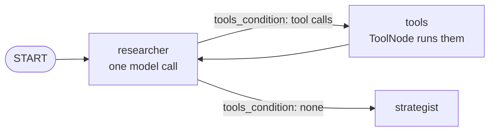

# The agent loop in LangGraph

> In LangGraph, the agent loop is drawn in the graph: a model node, a tools node, and edges that send the run back and forth until the model stops asking for tools.

## What it is

An agent works in [[What is a turn|turns]]: the model is called, the tools it asked for run, and the model is called again with the results, until it answers without asking for anything ([[What is a loop]]). LangChain runs this loop for you inside `create_agent` ([[The agent loop in LangChain]]). In LangGraph you build it yourself, out of nodes and edges, so you see each turn as steps of the graph, and you decide how it stops.

## Its components

- **The model node**: calls the model once per turn, with the tools bound, and adds its reply to the conversation ([[Agents in LangGraph]]).
- **The tools node**: runs every tool call in the last reply, and adds each result to the conversation ([[Tools in LangGraph]]).
- **The router**: after the model node, looks at the reply. Tool calls: go to the tools node. None: the loop is over.
- **The edge back**: after the tools node, always back to the model node.
- **The conversation**: a state key that keeps every request and result, so each model call sees everything so far ([[State in LangGraph]]).
- **A stop of your own**: a limit you write, in case the model never stops asking.

## How LangGraph implements it

- **The conversation**: `messages: Annotated[list[AnyMessage], add_messages]` in the state. The reducer appends what each node returns, so a node returns only its new messages.
- **The tools node**: `ToolNode([...])`, from `langgraph.prebuilt`. It runs all the calls of one reply in **one** graph step.
- **The router**: `tools_condition`, also prebuilt. It returns `"tools"` if the last message has tool calls, and `END` if not; map `END` to the next node if the loop isn't the end of the graph.
- **The edges**: `add_conditional_edges("model", tools_condition, {...})` and `add_edge("tools", "model")`.
- **Your own stop**: the model node counts the tool calls so far, and stops binding the tools after a maximum, so the model can only answer in text.
- **The backstop**: the recursion limit, `config={"recursion_limit": N}`, ends a run that takes more than N graph steps, with a `GraphRecursionError` ([[Errors and retries in LangGraph]]).

## Example

Take a researcher agent that measures the returns and risk of three funds (equity, bond and cash), with two tools: `get_returns(days)`, for at most 365 days, and `get_volatility(fund)`. Its loop:

```python
graph.add_node("researcher", researcher)
graph.add_node("tools", ToolNode([get_returns, get_volatility]))
graph.add_conditional_edges("researcher", tools_condition, {"tools": "tools", END: "strategist"})
graph.add_edge("tools", "researcher")
```



Its run takes four turns. Each turn is a `researcher` step, plus a `tools` step if it asked for tools, so the loop is seven graph steps. What each step adds to `messages`:
1. `researcher`: a call, `get_returns(days=500)`;
2. `tools`: the error, days must be at most 365, *"Please fix the error and try again."*;
3. `researcher`: a call, `get_returns(days=90)`;
4. `tools`: equity +4%, bond +1%, cash +0.5%;
5. `researcher`: two calls, `get_volatility("equity")` and `get_volatility("bond")`;
6. `tools`: both results, in **one** step: 15% and 5%;
7. `researcher`: the notes, with no tool call, so the router sends the run on to the strategist.

At step 7 the model compares the 90-day returns with the volatility because both are in `messages`. And the researcher node has its own stop: it counts the tool calls made so far, and after 6 it calls the model **without** tools:

```python
calls_so_far = sum(len(m.tool_calls) for m in state["messages"] if isinstance(m, AIMessage))
tools = [get_returns, get_volatility] if calls_so_far < 6 else []
model_now = model.bind_tools(tools) if tools else model
```

## Watch out
- **Stopping is your job.** Without your own count, a model that keeps calling tools runs until the recursion limit fails the run, and the default limit is 10,007 steps.
- **The conversation grows.** Every turn resends all of it, so keep tool results small.

## Related
[[LangGraph Overview]] · [[Tools in LangGraph]] · [[Branches in LangGraph]] · [[State in LangGraph]] · [[What is a turn]] · [[What is a loop]] · [[The agent loop in LangChain]]

## My notes & questions
