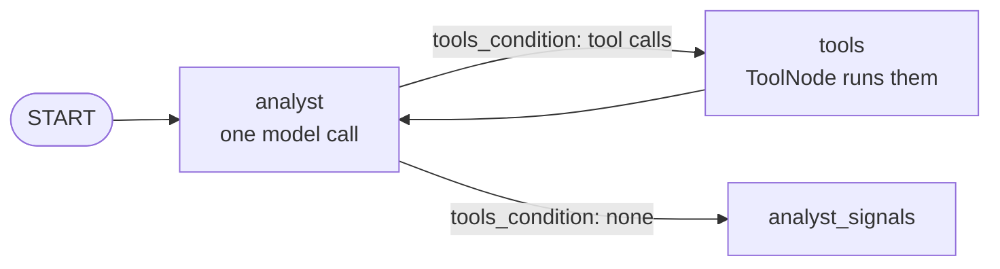

# The agent loop in LangGraph

> In LangGraph, the agent loop is drawn in the graph: two nodes, `analyst` and `tools`, and an edge that sends the run back and forth until the model stops asking for tools.

## Context

On 31 January 2025, the analyst researches the assets with `get_asset_statistics`. Here is a real-looking run, node by node. Each row is one node run, and the last column shows what it added to `messages`:

| Graph step | Node | New messages in the state |
|---|---|---|
| 1 | `analyst` | system prompt, "Research the assets.", AI: call `get_asset_statistics(lookback_days=1)` |
| 2 | `tools` | Tool: "Error: lookback_days: Input should be greater than or equal to 5 … call the tool again." |
| 3 | `analyst` | AI: call `get_asset_statistics(lookback_days=90)` |
| 4 | `tools` | Tool: `{"SPX": {"mean_return": ..., ...}, ...}` |
| 5 | `analyst` | AI: call `get_asset_statistics(lookback_days=365)` |
| 6 | `tools` | Tool: the 365-day statistics |
| 7 | `analyst` | AI: "SPX looks strong over both windows, …" (**no tool call**) |
| 8 | `analyst_signals` | none: it reads the research and writes `signals` |

That's 4 [[What is a turn|turns]] (the `analyst` runs) and 8 graph steps. The model made a mistake at step 1, read the error at step 2, and fixed it.

## How the loop is built

```python
# workflow.py
graph.add_node("analyst", partial(analyst, llm=llm))                                   # the model
graph.add_node("tools", ToolNode([get_asset_statistics], handle_tool_errors=tool_error))  # runs calls
graph.add_conditional_edges("analyst", tools_condition, {"tools": "tools", END: "analyst_signals"})
graph.add_edge("tools", "analyst")                                                     # back
```



Three pieces make it work:
1. **`analyst`** calls the model once, with the tool bound, and returns its reply as a new message.
2. **`tools_condition`** is a prebuilt router ([[Branches in LangGraph]]). It looks at the last message: if it contains tool calls, go to `tools`; if not, go to `END`, which `workflow.py` maps to `analyst_signals`.
3. **`tools`** (a `ToolNode`) runs every call in the last message and returns the results as `ToolMessage`s ([[Tools in LangGraph]]).

## The memory: `messages`

Each `analyst` run sends the model **the whole conversation so far**, so at step 7 it can compare the 90-day and 365-day results. That conversation lives in the state key `messages`. Its reducer, `add_messages`, appends what each node returns instead of replacing the list ([[State in LangGraph]]):

```python
# agents.py, analyst (shortened)
messages = state.get("messages", [])
reply = model.invoke([*messages, *new], ...)
return {"messages": [*new, reply]}        # only the new ones; add_messages appends them
```

## How it stops

```python
rounds = sum(isinstance(m, AIMessage) and bool(m.tool_calls) for m in messages)
model = llm.bind_tools([get_asset_statistics]) if rounds < MAX_TOOL_ROUNDS else llm
```

The analyst counts how many of its earlier replies called a tool. After `MAX_TOOL_ROUNDS` (4) it calls the model **without** the tool, so the model can only answer in text, and `tools_condition` sends the run on. `recursion_limit` (40 node runs per date) is only a backstop.

## Compared with LangChain

It's the same model ⇄ tools loop that `create_agent` runs inside one node ([[The agent loop in LangChain]]). Here you see each step as a node, in the code and in Langfuse, and you can change it: add a node in the middle, route somewhere else, stop on your own condition.

## Watch out
- **Stopping is your job.** Without the `MAX_TOOL_ROUNDS` check, a model that keeps calling tools would run until `recursion_limit` fails the date.
- **The conversation grows.** Every turn resends all of it, so keep tool results small.

## Related
[[Tools in LangGraph]] · [[Branches in LangGraph]] · [[State in LangGraph]] · [[What is a turn]] · [[The agent loop in LangChain]]

## My notes & questions
