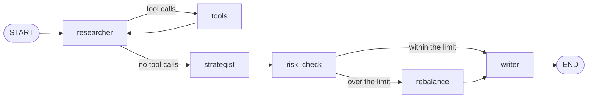

# Workflow in LangGraph

> In LangGraph, a workflow is a **graph**: every step of the work is a **node**, and you draw every connection between them yourself.

## What it is

An agentic system is several steps that must run in the right order: some one after the other, some only when a condition holds, some again and again. A **workflow** is that order, written down. In LangGraph you write it as a graph, so the whole process can be read off one drawing, and nothing runs that isn't in it.

## Its components

- **The state**: the dictionary every step reads from and writes to, so the steps can hand results to each other. The graph is built around it ([[State in LangGraph]]).
- **Nodes**: the steps. Each one is a plain Python function that receives the state and returns the keys it produced. A node may call a model ([[Agents in LangGraph]]), run plain code, or be a ready-made node from LangGraph, like the `ToolNode` that runs tools ([[Tools in LangGraph]]).
- **Edges**: what runs next. A **plain edge** always goes from one node to the same next one. A **conditional edge** calls a small function, the **router**, which picks the next node ([[Branches in LangGraph]]).
- **`START` and `END`**: two special names, for where the run enters the graph and where it stops.
- **Compiling**: turning the drawing into something you can run. LangGraph checks it (no edge to a missing node, for example) and returns a runnable graph.

## How LangGraph implements it

Building and running a graph takes four moves:
1. **Create the graph** with its state, and optionally the shape of its **context**, the fixed values for a run: `StateGraph(MyState, context_schema=MyContext)`.
2. **Add the nodes**: `graph.add_node("name", function)`. A node can also get a `retry_policy`, to rerun it when it fails ([[Errors and retries in LangGraph]]).
3. **Add the edges**: `graph.add_edge("a", "b")` for a plain edge, `graph.add_conditional_edges("a", router, [...])` for a branch or a loop.
4. **Compile and run**: `workflow = graph.compile()`, then `workflow.invoke(first_state, context=..., config=...)`. `invoke` returns the final state.

Each node run is one **graph step**. The run ends when it reaches `END` (or a node with no edge out), and fails when it takes more steps than the **recursion limit** allows.

## Example

Take a system that builds a portfolio from three funds (equity, bond and cash), with at most 40% in equity. A researcher measures the funds with tools, a strategist proposes weights, a risk check enforces the limit, and a writer explains the result:

```python
from langgraph.graph import END, START, StateGraph
from langgraph.prebuilt import ToolNode, tools_condition

graph = StateGraph(PortfolioState, context_schema=Mandate)
graph.add_node("researcher", researcher)
graph.add_node("tools", ToolNode([get_returns, get_volatility]))
graph.add_node("strategist", strategist)
graph.add_node("risk_check", risk_check)
graph.add_node("rebalance", rebalance)
graph.add_node("writer", writer)

graph.add_edge(START, "researcher")
graph.add_conditional_edges("researcher", tools_condition, {"tools": "tools", END: "strategist"})
graph.add_edge("tools", "researcher")                       # the loop back
graph.add_edge("strategist", "risk_check")
graph.add_conditional_edges("risk_check", after_check, ["writer", "rebalance"])
graph.add_edge("rebalance", "writer")
graph.add_edge("writer", END)

workflow = graph.compile()
result = workflow.invoke({"messages": [HumanMessage("Research the funds.")]},
                         context=Mandate(("equity", "bond", "cash"), 0.40))
```



The run goes like this:
1. the `researcher` and `tools` nodes take turns until the researcher writes its notes, in four [[What is a turn|turns]] ([[The agent loop in LangGraph]]);
2. the `strategist` proposes equity 55%, bond 30%, cash 15%;
3. the `risk_check` finds equity over the limit, so the graph goes to `rebalance`, which approves equity 40%, bond 40%, cash 20%;
4. the `writer` explains it.

That's 11 graph steps. With weights that pass the check, `rebalance` would be skipped: the drawing shows every possible route, and each run takes one.

## Watch out
- **Every loop needs an exit.** The recursion limit stops a runaway graph only with an error, and its default is very high (10,007): set your own, e.g. `config={"recursion_limit": 30}`.
- **The drawing is the program.** A node with no edge into it never runs, and a node with no edge out ends the run there, without any error.

## Related
[[LangGraph Overview]] · [[State in LangGraph]] · [[Branches in LangGraph]] · [[Agents in LangGraph]] · [[The agent loop in LangGraph]] · [[Workflow in LangChain]]

## My notes & questions
