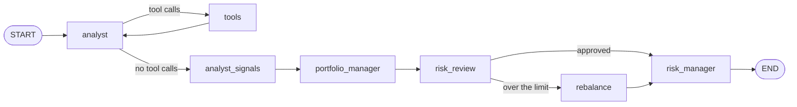

# Workflow in LangGraph

> In LangGraph, every step of the work is a **node** in a graph, and you draw every connection between them yourself.

## Context

[[The hackathon task]] has three roles: analyst, portfolio manager, risk. In the LangGraph system, each piece of their work becomes its own node. On 31 January 2025, the run goes like this:

1. **analyst** asks for statistics, and **tools** runs the request. The two take turns until the analyst has what it needs.
2. **analyst_signals** turns the analyst's research into a signal per asset.
3. **portfolio_manager** turns the signals into weights.
4. **risk_review** checks them: US assets are at 25%, over the 20% limit.
5. So the graph goes to **rebalance**, which scales the US assets down to 20%.
6. **risk_manager** explains the result.



On a date where the weights pass the check, step 5 doesn't happen: the graph goes straight from `risk_review` to `risk_manager`. The drawing shows *every* possible route, and each date takes one of them.

## A graph: nodes and edges

A **node** is a plain Python function. It receives the shared state and returns the keys it changes ([[State in LangGraph]]). The graph has three kinds:
- **LLM nodes** call the model: `analyst`, `analyst_signals`, `portfolio_manager`, `risk_manager` ([[Agents in LangGraph]]);
- **plain-Python nodes** never call a model: `risk_review`, `rebalance`;
- **prebuilt nodes** come from LangGraph: `tools` is a `ToolNode` ([[Tools in LangGraph]]).

An **edge** says what runs next. A normal edge always goes from A to B. A **conditional edge** calls a small function, the **router**, which picks the next node ([[Branches in LangGraph]]).

Building the graph takes three moves:

```python
# workflow.py (shortened)
graph = StateGraph(PortfolioState)                                   # 1. the shared state
graph.add_node("portfolio_manager", partial(portfolio_manager, llm=llm), retry_policy=LLM_RETRY)
graph.add_node("risk_review", risk_review)                           # 2. nodes...
graph.add_edge("portfolio_manager", "risk_review")                   #    ...and edges
graph.add_conditional_edges("risk_review", after_review, ["risk_manager", "rebalance"])
workflow = graph.compile().with_config(recursion_limit=RECURSION_LIMIT)   # 3. make it runnable
```

`partial(portfolio_manager, llm=llm)` fixes the `llm` argument, so the node can be called with the state alone. `core/run.py` then runs the compiled graph once per date with `workflow.invoke({"reporting_date": "2025-01-31"})`.

## Compared with LangChain

| | LangGraph system | LangChain system ([[Workflow in LangChain]]) |
|---|---|---|
| the analyst's tool loop | drawn: `analyst ⇄ tools` | hidden inside `create_agent` |
| the risk check | two nodes and a branch | middleware on the portfolio manager |
| what you see in Langfuse | every node, every date | one node per agent |

More lines to write, but nothing is hidden: you can read the whole process off `workflow.py`.

## Watch out
- **Every loop needs an exit.** `recursion_limit` (40) caps the number of node runs per date, as a backstop. The real stop for the analyst loop is `MAX_TOOL_ROUNDS` ([[The agent loop in LangGraph]]).
- **`core/` is fixed.** The graph must accept `{"reporting_date": ...}` and end with `approved_weights` in the state.

## Related
[[The hackathon task]] · [[State in LangGraph]] · [[Branches in LangGraph]] · [[Agents in LangGraph]] · [[Workflow in LangChain]]

## My notes & questions
