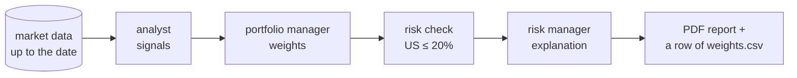

# The hackathon task

> Build a team of AI agents that, on each reporting date, reads market data and decides how to (re)balance an investment portfolio.

**Every reporting date produces two things: a report (one PDF) and a row of weights.** The report is part of what is evaluated, not just the weights.

## Context

You manage a portfolio of financial assets: equity indices, government and corporate bond indices, and money-market rates, in the United States and the euro area. Once per **reporting date** (e.g. 31 January 2025), you decide which share of the money goes into each asset: the **weights**, which sum to 100%. Next month you decide again, and the weights change. That's **rebalancing**.

In a bank, three people would do this, one after the other. The template builds the same team out of agents:

1. **Analyst.** Looks at the data and gives every asset a signal: *high*, *neutral* or *low*.
2. **Portfolio manager.** Turns the signals into weights.
3. **Risk check.** Checks the weights against a rule (US assets ≤ 20% in total) and fixes them if needed. Then a **risk manager** explains the result.

## One reporting date, step by step
*(Numbers made up, and only a few assets: the real universe has more.)*

1. **Analyst** reads the statistics of the prices up to 31 Jan 2025 and gives a signal per asset: European equities high, the other assets neutral.
2. **Portfolio manager** proposes European equities 40%, euro money-market 20%, euro government bonds 15%, US equities 15%, US government bonds 10%.
3. **Risk check.** The US assets (US equities and US government bonds) make 25%: over the 20% limit. It scales them down to 20% in total and the others up to 80%.
4. **Risk manager** writes: "US exposure was 25%, above the 20% limit; the US assets were scaled down…"
5. **Output.** The date produces **its report** (`2025-01-31.pdf`: the analysis, the decision and the risk explanation) and **one row of `weights.csv`**. Then the next date starts.

## The rule that's easy to break: no look-ahead

The data files contain the **whole history**, including the months after 31 January 2025. On 31 January you couldn't know February's prices, so every piece of code that reads data must cut it at the reporting date (`end_date=`). That's why the date is never something the model chooses: our code passes it in ([[Tools in LangChain]]).

## What's deliberately simple

The template works end to end, but each part is a starting point for teams to improve:
- the analyst only sees price statistics; `financial.csv` and `macro.csv` aren't used yet;
- only `assets_metadata.csv` is used, and only for the "US" rule; `financial_metadata.csv` and `macro_metadata.csv` (what each series is, its frequency and units) are yours to use;
- there's one risk rule.

## Where each idea is explained

The framework notes explain each idea on a small made-up example, [[The running example]] (three funds, no real data), not on this task. To choose a library, see [[LangChain or LangGraph]].

| Part of the task | LangChain notes | LangGraph notes |
|---|---|---|
| an agent, and the analyst's run in detail | [[Agents in LangChain]], [[The agent loop in LangChain]] | [[Agents in LangGraph]], [[The agent loop in LangGraph]] |
| the analyst fetching data | [[What is a tool]], [[Tools in LangChain]], [[Skills in LangChain]] | [[What is a tool]], [[Tools in LangGraph]] |
| signals and weights in a fixed form | [[Schemas in LangChain]] | [[Schemas in LangGraph]] |
| the risk check, limits, the date in the prompt | [[Middleware in LangChain]], [[Hooks in LangChain]] | [[Branches in LangGraph]], [[Errors and retries in LangGraph]] |
| passing results from one agent to the next | [[State in LangChain]] | [[State in LangGraph]] |
| the order: analyst → portfolio manager → risk | [[Workflow in LangChain]] | [[Workflow in LangGraph]] |

## Related
[[Agents in LangChain]] · [[Workflow in LangChain]] · [[State in LangChain]]

