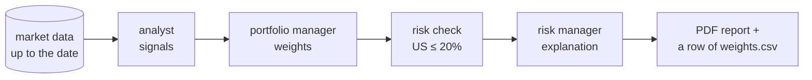

# The hackathon task

> Build a team of AI agents that, on each reporting date, reads market data and decides how to (re)balance an investment portfolio.

## Context

You manage a portfolio of financial assets: equity indices (`SPX`, `NDX`), bond indices (`TRXVUSGOV*U`, `IBBUS0172`) and money-market rates (`EUROSTR=`, `USDSOFR=`), among others. Once per **reporting date** (e.g. 31 January 2025), you decide which share of the money goes into each asset: the **weights**, which sum to 100%. Next month you decide again, and the weights change. That's **rebalancing**.

In a bank, three people would do this, one after the other. The template builds the same team out of agents:

1. **Analyst.** Looks at the data and gives every asset a signal: *high*, *neutral* or *low*.
2. **Portfolio manager.** Turns the signals into weights.
3. **Risk check.** Checks the weights against a rule (US assets ≤ 20% in total) and fixes them if needed. Then a **risk manager** explains the result.

## One reporting date, step by step
*(Numbers made up, and only six assets: the real universe has more.)*

1. **Analyst** reads the statistics of the prices up to 31 Jan 2025 and answers: `SPX` high, `NDX` neutral, `EUROSTR=` neutral, `TRXVUSGOV*U` neutral, `USDSOFR=` neutral, …
2. **Portfolio manager** proposes `SPX` 30%, `NDX` 25%, `EUROSTR=` 20%, `TRXVUSGOV*U` 15%, `USDSOFR=` 10%.
3. **Risk check.** The template counts an asset as US if its name contains "US", so `TRXVUSGOV*U` and `USDSOFR=` together make 25%: over the 20% limit. It scales the US assets down to 20% (15% → 12%, 10% → 8%) and the others up to 80% (`SPX` 32%, `NDX` 26.7%, `EUROSTR=` 21.3%).
4. **Risk manager** writes: "US exposure was 25%, above the 20% limit; the US assets were scaled down…"
5. **Output.** `core/` writes the approved weights as one row of `weights.csv` and the explanations into `2025-01-31.pdf`. Then the next date starts.

## The rule that's easy to break: no look-ahead

The data files contain the **whole history**, including the months after 31 January 2025. On 31 January you couldn't know February's prices, so every piece of code that reads data must cut it at the reporting date (`end_date=`). That's why the date is never something the model chooses: our code passes it in ([[Tools in LangChain]]).

## What's deliberately simple

The template works end to end, but each part is a starting point for teams to improve:
- the analyst only sees price statistics; `financial.csv` and `macro.csv` aren't used yet;
- the "US" rule misses `SPX` and `NDX`, which are US equity indices;
- there's one risk rule.

## Where each part is explained

| Part of the task | LangChain notes |
|---|---|
| an agent, and the analyst's run in detail | [[Agents in LangChain]], [[The agent loop in LangChain]] |
| the analyst fetching data | [[What is a tool]], [[Tools in LangChain]], [[Skills in LangChain]] |
| signals and weights in a fixed form | [[Schemas in LangChain]] |
| the risk check, limits, the date in the prompt | [[Middleware in LangChain]], [[Hooks in LangChain]] |
| passing results from one agent to the next | [[State in LangChain]] |
| the order: analyst → portfolio manager → risk | [[Workflow in LangChain]] |

## Related
[[Agents in LangChain]] · [[Workflow in LangChain]] · [[State in LangChain]]

