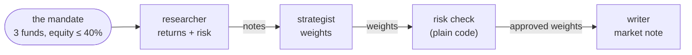

# The running example

> Every note in this vault explains its idea on the same small system: three AI agents that build a portfolio from three funds. This page tells the whole run once, step by step. The other notes zoom in on one step.

*The funds, the numbers and the rules are made up for the example.*

## The request

*"Build a portfolio from three funds, the Equity Fund, the Bond Fund and the Cash Fund, with at most 40% in equity."*

The **mandate** (which funds may be used, and the 40% equity limit) is given by **our program**, not chosen by the model. The model can read it, but it can't change it.

Three agents work one after the other, each passing its result to the next:

## The researcher: 4 turns

The researcher has two **tools**, functions it can ask our program to run ([[What is a tool]]):
- `get_returns(days)`: the return of every fund over the last `days` days (5 to 365);
- `get_volatility(fund)`: how much one fund's price moves up and down (`equity`, `bond` or `cash`).

It also has one **skill**, a written method: *"measure the returns first; then check the volatility of the funds that move; compare each fund's return with its risk"*.

Its run takes **4 turns** (a turn is one model call plus the tools it asked for: [[What is a turn]]):

| Turn | The model asks for… | …and gets back |
|---|---|---|
| 1 | `get_returns(days=500)` | an error: *"days: Input should be less than or equal to 365"*. The tool doesn't run. |
| 2 | `get_returns(days=90)` | equity +4%, bond +1%, cash +0.5% |
| 3 | `get_volatility("equity")` **and** `get_volatility("bond")`, in one reply | equity 15%, bond 5% |
| 4 | nothing: it writes its notes | *"Equity: +4% over 90 days, volatility 15%. Bond: +1%, volatility 5%. Cash: +0.5%, almost no risk."* |

## The strategist: 2 turns

The strategist turns the notes into **weights**, the share of the portfolio in each fund, in a **fixed form**: one weight for every fund, and a short rationale ([[Schemas in LangChain]]).

1. Its first answer gives equity 60% and bond 40%, and forgets cash. Our code rejects it: *"Every fund needs a weight; missing: ['cash']"*.
2. It answers again: **equity 55%, bond 30%, cash 15%**, because equity has the best return for its risk.

## The risk check

Plain code, not a model: equity is at 55%, over the 40% limit. The check caps equity at 40% and gives the 15 points it removed to the other funds, in proportion to their weights: **equity 40%, bond 40%, cash 20%**. It records what it changed, so the writer can say so.

A rule that must always hold is enforced by code, whatever the model wrote.

## The writer: 1 turn

The writer has no tools and no fixed form. It reads the approved weights and the risk check's record, and writes a short market note: one model call, one turn.

## Where each step is explained

How the ideas fit together in LangChain, as one story: [[LangChain Overview]].

| Step | LangChain |
|---|---|
| an agent, and what `create_agent` builds | [[Agents in LangChain]] |
| the 4 turns of the researcher | [[What is a loop]], [[The agent loop in LangChain]], [[What is a turn]] |
| `get_returns`, `get_volatility`, the bad `days=500` | [[What is a tool]], [[Tools in LangChain]] |
| the mandate reaching the tools, hidden from the model | [[Runtime in LangChain]] |
| the "returns, then risk" method | [[Skills in LangChain]] |
| the weights' fixed form, the rejected first answer | [[Schemas in LangChain]] |
| the risk check, limits, retries | [[Middleware in LangChain]], [[Hooks in LangChain]] |
| passing notes and weights between agents | [[State in LangChain]] |
| researcher → strategist → writer | [[Workflow in LangChain]] |

Not sure which library to use? See [[LangChain or LangGraph]].

## My notes & questions
