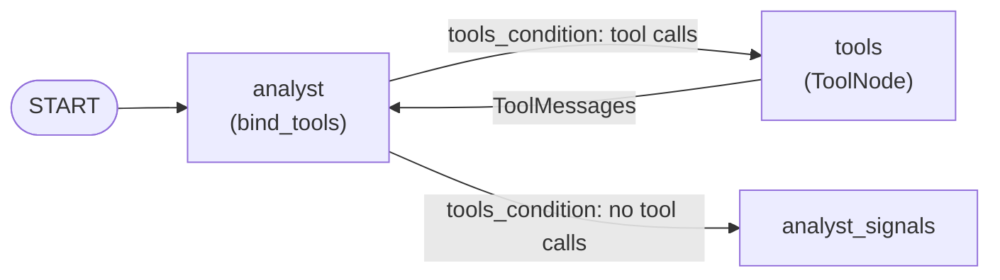

# Tools in LangGraph

> The model only **asks** for a tool. In LangGraph, running it is a node you add to the graph.

## Context
The LangGraph system does the same job as the [[Agents in LangChain#Context|running example]]: the analyst asks for statistics over 90 and 365 days, then gives the signals. In LangChain, `create_agent` hides who runs the tool. Here you can see it, because it's a node in the graph: `analyst` asks, `tools` runs, and the graph goes back to `analyst`.

## The idea
A **tool** is a Python function with `@tool`. Its name, docstring and input schema are what the model reads. `llm.bind_tools([...])` sends that description with every request. The model then replies in one of two ways: with text, or with a **tool call** such as `{"name": "get_asset_statistics", "args": {"lookback_days": 90}, "id": "call_1"}`. At that point nothing has run yet. A tool call is just a request.

You have to run the call yourself, and in LangGraph that is a step you draw. The prebuilt **`ToolNode`** runs the calls in the last message. It adds each result as a **`ToolMessage`** carrying the same `id`, so the model knows which request the result answers. **`tools_condition`** routes the graph: if the reply has tool calls, go to `tools`, otherwise move on. The result is a loop:



So `bind_tools` and `ToolNode` aren't two options to choose between. They are two halves of the same tool: `bind_tools` says **what the model may ask for**, and `ToolNode` says **who runs it**.

Binding without a node still has a use. If you bind a Pydantic schema (a class, not a function) and force a call (`tool_choice="required"`), the model's arguments *are* the answer. You read and validate them, and nothing needs running. This is how `ask_for_answer` gets structured output.

| Use | What you bind | Needs a `tools` node? |
|---|---|---|
| Fetch data / act | a function (`get_asset_statistics`) | yes: `ToolNode` runs it |
| Structured answer | a schema (`Analysis`) | no: you read `tool_calls[0]["args"]` |

## Example
```python
# agents.py (analyst node): offer the tool
model = llm.bind_tools([get_asset_statistics]) if rounds < MAX_TOOL_ROUNDS else llm

# workflow.py: run it, and loop back
graph.add_node("tools", ToolNode([get_asset_statistics], handle_tool_errors=tool_error))
graph.add_conditional_edges("analyst", tools_condition, {"tools": "tools", END: "analyst_signals"})
graph.add_edge("tools", "analyst")
```
The tool is listed twice: once so the model knows it exists, and once so the graph can run it.

## Watch out
- **The loop must end.** Here the analyst stops offering the tool after `MAX_TOOL_ROUNDS`, so the model has to answer. `recursion_limit` is only a backstop.
- **Errors go back to the model.** `handle_tool_errors=tool_error` turns a failed call into a `ToolMessage`, so the model reads the error and can retry instead of the run crashing.
- **Hidden inputs.** A `runtime: ToolRuntime` parameter isn't shown to the model. The tool reads the reporting date from `runtime.state`, so the model can't pick a different date.

## Related
[[What is a tool]] · [[Tools in LangChain]]

## My notes & questions
