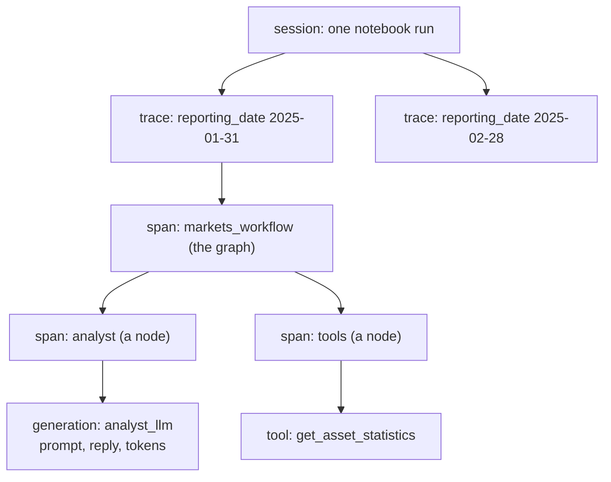

# Tracing and Langfuse

> Tracing records what a program did, step by step: every call, its input and output, how long it took and whether it failed. Langfuse is the web app where the template sends its traces, and where you (and the organisers) look at them.

## Context

In ordinary code, when something goes wrong you read the code and the error. With an LLM, most of the decisions happen *inside model calls*: which tool to call, with which arguments, what to answer. You can't read those decisions in your code, and the model may decide differently on the next run.

*Example:* an assistant answers "The capital of Australia is Sydney". Was the model wrong on its own? Did a search tool return a bad page? Was the prompt missing context? Only the record of what was actually sent and received can tell you. That record is a **trace**.

## Terminology

| Word | What it is | In the template |
|---|---|---|
| **trace** | the record of one task, from start to end | one reporting date |
| **observation** | one step inside a trace, with input, output, start and end time, status | a node, a model call, a tool call |
| **span** | an observation for any piece of work | the date's root (`reporting_date 2025-01-31`), a graph node (`analyst`) |
| **generation** | an observation that is a model call: prompt, reply, model name, token counts | `analyst_llm` |
| **tool** | an observation that is a tool call | `get_asset_statistics` |
| **session** | a group of traces that belong together | one run of the notebook: all the dates you ran with one `start_session()` |
| **tags, user, metadata** | labels attached to a trace, for filtering | tags `markets-agent`, the model, `team:…`, `date:…` |
| **level** | how serious an observation is: `DEBUG`, `DEFAULT`, `WARNING`, `ERROR` | a failed date is `ERROR` |

Observations **nest**. A step contains the steps it called, so a trace reads like a call tree:



## How it is set up

**You don't write any tracing code.** `core/` does it all, as long as three environment variables are set:
- `LANGFUSE_PUBLIC_KEY`
- `LANGFUSE_SECRET_KEY`
- `LANGFUSE_BASE_URL`


Here is what `core/` does with the Langfuse SDK, shortened:

```python
from langfuse import get_client, propagate_attributes
from langfuse.langchain import CallbackHandler

langfuse = get_client()                                     # reads the three variables
try:
    with (
        # 1. the root observation: one trace per reporting date
        langfuse.start_as_current_observation(name="reporting_date 2025-01-31",
                                              input={"reporting_date": "2025-01-31"}) as span,
        # 2. labels copied onto every observation inside
        propagate_attributes(session_id=session.id, user_id=owner, trace_name="markets-portfolio",
                             tags=["markets-agent", model, f"team:{team}", "date:2025-01-31"]),
    ):
        # 3. the callback records every node, model call and tool call of your workflow
        result = workflow.invoke({"reporting_date": "2025-01-31"},
                                 config={"callbacks": [CallbackHandler()], "run_name": "markets_workflow"})
        span.update(output={"files": {...}, "weights_sha256": ...})   # the date's signatures
finally:
    langfuse.flush()                                        # 4. send now, even if the date failed
```

1. **`start_as_current_observation`** opens the trace's root observation. Everything recorded inside becomes its child. If the date fails, the root is marked `ERROR` with the error message.
2. **`propagate_attributes`** attaches the session id, user, trace name and tags to every observation. The session id is the same as your output folder's name.
3. **`CallbackHandler`** is an object LangChain and LangGraph call at the start and end of every step. It records your nodes, model calls (with their tokens) and tool calls. That's why your own nodes need no tracing code.
4. **`flush()`** sends what's been recorded. The SDK sends in the background, so this makes sure nothing is lost when the notebook stops.

**Name your model calls.** An observation is named after its node, or after the `run_name` you pass. In the LangGraph, model calls pass `config={"run_name": f"{agent}_llm"}`, so they show as `analyst_llm` or `risk_manager_llm`. Do the same for any model call you add.

## What the UI shows

### Tracing: every trace

![[langfuse-tracing-list.png]]

The **Tracing** page lists traces. 

The filter `isRootObservation: true` (top) keeps one row per trace, i.e. one row per reporting date. 

For each one you see the name (`reporting_date 2025-03-28`), the trace name (`markets-portfolio`), its input (`{"reporting_date": ...}`) and its output (the PDF's SHA-256 and the weights' signature). 

The filters on the left narrow it down by name, type or environment.

### Sessions: one row per run

![[langfuse-sessions-list.png]]

The **Sessions** page lists your runs. 

The ID is the session id (the same as the output folder's name). 

You also see how long the run took, its environment, the user and the number of traces (equal to the number of reporting dates). 

### A session: its dates

![[langfuse-session-page.png]]

Opening a session shows each of its traces, one card per date, with its input, output and metadata. The header shows the total number of traces, the total cost and the user. Click a trace's name, on the right, to open it.

### A trace: every step

![[langfuse-trace-detail.png]]

This is the page you'll use most. It has three parts:
- **The tree (left)** shows every observation, nested, with its duration. Here: `reporting_date 2025-01-31` (34.62 s) → `markets_workflow` → `analyst` → `analyst_llm` (0.42 s, `288 → 61` tokens) → `tools_condition` → `tools` → `get_asset_statistics` → `analyst` again… The last `analyst_llm` took **17.10 s** and wrote 3,495 tokens: that's where the time went.
- **The details (right)** belong to whatever you click in the tree. For the trace's root: total latency, session, user, total tokens (`12,261 prompt → 6,696 completion`), the tags, the input, the output (PDF hash and weights signature) and the metadata. For a generation: the full prompt sent to the model, and its reply.
- **The graph (bottom left)** draws the trace as a graph, which makes loops and branches easy to see.

## How to use it

1. **Find the date.** Open **Sessions**, then your session, then the date. Or open **Tracing** and filter by name.
2. **Walk down the tree** to the step that looks wrong: a red observation, one much slower than the others, a tool called again and again.
3. **Click it, and read its input and output.** For a generation, the input is exactly what the model was told.

| You see | It means |
|---|---|
| an observation in **red**, level `ERROR` | where it failed; the error message is on that observation |
| completion tokens **equal to `max_tokens`** | the reply was cut off. Reasoning models (like `gpt-oss`) count their hidden thinking too, so they can run out before writing the answer |
| one step much **slower** than the others | a long reply, a slow tool, or retries |
| "Your last answer was invalid: …" in a prompt | the model was corrected and asked again |
| "Error: … call the tool again" as a tool's output | a bad tool call, which the model can fix |
| the same tool called again and again | the model is looping: it needs a clearer prompt or a limit |
| a generation's **input** missing some data | the model couldn't know it: many "wrong answers" come from here |

### Example: a date that failed

A run of the LangChain system stopped on 28 February 2025 with:

```text
ValueError: analyst gave no valid answer within its call limit.
```

The message suggests a call limit, but the trace shows what actually happened.

**1. Open the failed trace.**

![[langfuse-error-trace.png]]

- In **Tracing**, the date's row leads to a trace marked **ERROR**. In the tree, the red `ERROR` labels go down to `analyst`, so the failure is inside the analyst.
- On the right, the **Output** shows `files: {}`: no PDF was written for this date.

**2. Scroll down to the step that stands out, and click it.**

![[langfuse-error-generation.png]]

- The last `model` step is red and took **40.17 s**.
- Its generation (`TrackedChatOpenAI`) shows `3,462 prompt → 8,192 completion`, and the call's settings: `max_tokens: 8192`, `temperature: 0`. The reply used **exactly** the token limit.
- Its **Output** is `content: ""`: an empty reply, with no tool call in it.

**3. Put it together.** The model is a reasoning model, and its hidden reasoning counts towards `max_tokens`. It spent all 8,192 tokens thinking and was cut off before writing anything. A reply without a tool call ends the agent's loop, so the agent finished without an answer. 

**4. Fix it.** Give the reply more room with `get_llm("openai/gpt-oss-120b", max_tokens=16384)`, or make the prompt more direct so the model reasons less. 

