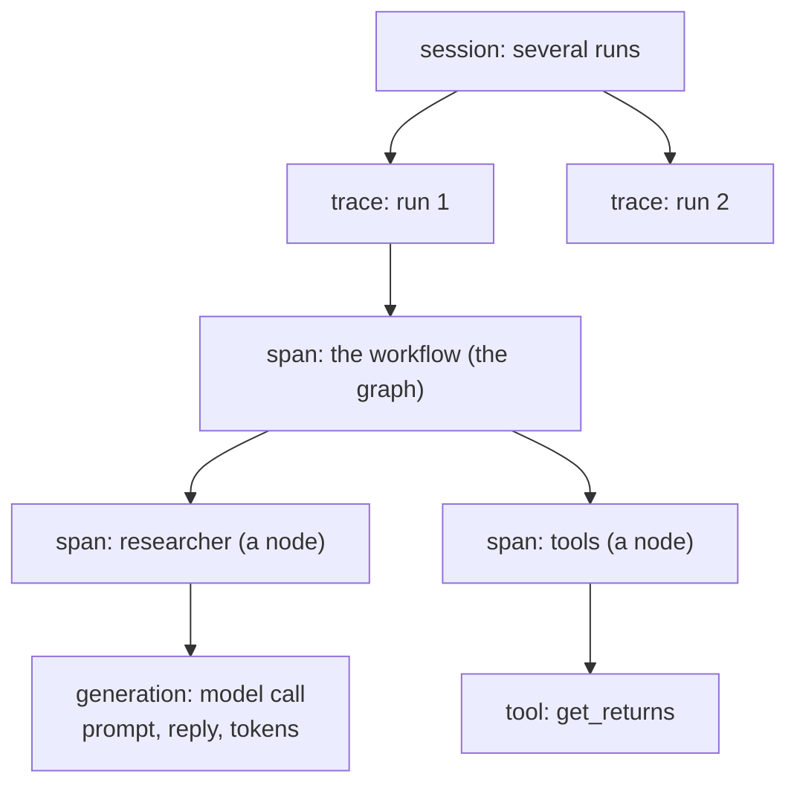

# Tracing and Langfuse

> Tracing records what a program did, step by step: every call, its input and output, how long it took and whether it failed. Langfuse is a web app that stores those records and shows them to you.

## What it is

In ordinary code, when something goes wrong you read the code and the error. With an LLM, most of the decisions happen *inside model calls*: which tool to call, with which arguments, what to answer. You can't read those decisions in your code, and the model may decide differently on the next run.

*Example:* an assistant answers "The capital of Australia is Sydney". Was the model wrong on its own? Did a search tool return a bad page? Was the prompt missing context? Only the record of what was actually sent and received can tell you. That record is a **trace**.

## Its components

- **Trace**: the record of one task, from start to end, e.g. one run of an agentic workflow.
- **Observation**: one step inside a trace, with its input, output, start and end time, and status. Observations **nest**: a step contains the steps it called, so a trace reads like a call tree. There are three kinds:
  - **span**: any piece of work, e.g. the whole workflow, or one node of the graph;
  - **generation**: a model call, with the prompt, the reply, the model's name and the token counts;
  - **tool**: a tool call.
- **Session**: a group of traces that belong together, e.g. several runs started from the same notebook.
- **Tags, user, metadata**: labels attached to a trace, for filtering.
- **Level**: how serious an observation is: `DEBUG`, `DEFAULT`, `WARNING` or `ERROR`. A failed step is `ERROR`.



## How Langfuse implements it

Langfuse needs three environment variables: `LANGFUSE_PUBLIC_KEY`, `LANGFUSE_SECRET_KEY` and `LANGFUSE_BASE_URL`. Then four pieces of its Python SDK do the work:
1. **`start_as_current_observation`** opens the trace's root observation. Everything recorded inside becomes its child. If the run fails, the root is marked `ERROR` with the error message.
2. **`propagate_attributes`** attaches a session id, user, trace name and tags to every observation inside.
3. **`CallbackHandler`** is an object LangChain and LangGraph call at the start and end of every step. Passed in the run's `config`, it records every node, model call (with its tokens) and tool call. That's why your nodes need no tracing code of their own.
4. **`flush()`** sends what's been recorded. The SDK sends in the background, so this makes sure nothing is lost when the program stops.

```python
from langfuse import get_client, propagate_attributes
from langfuse.langchain import CallbackHandler

langfuse = get_client()                                     # reads the three variables
try:
    with (
        langfuse.start_as_current_observation(name="portfolio run", input=first_state) as span,   # 1. the root
        propagate_attributes(session_id="my-session", tags=["portfolio"]),                       # 2. labels
    ):
        result = workflow.invoke(first_state, context=mandate,
                                 config={"callbacks": [CallbackHandler()], "run_name": "workflow"})  # 3. every step
        span.update(output={"approved_weights": result["approved_weights"]})
finally:
    langfuse.flush()                                        # 4. send now, even if the run failed
```

**Name your model calls.** An observation is named after its node, or after the `run_name` you pass in the call's `config`, e.g. `model.invoke(messages, config={"run_name": "strategist_llm"})`. Clear names make the tree easy to read.

## What the UI shows

The screenshots below come from a sample agentic system; your names will differ.

### Tracing: every trace

![[langfuse-tracing-list.png]]

The **Tracing** page lists traces. The filter `isRootObservation: true` (top) keeps one row per trace. For each one you see its name, the trace name, its input and its output. The filters on the left narrow it down by name, type or environment.

### Sessions: one row per group of runs

![[langfuse-sessions-list.png]]

The **Sessions** page lists sessions, with how long they took, their environment, the user and the number of traces in each.

### A session: its traces

![[langfuse-session-page.png]]

Opening a session shows each of its traces, one card per trace, with its input, output and metadata. The header shows the total number of traces, the total cost and the user. Click a trace's name, on the right, to open it.

### A trace: every step

![[langfuse-trace-detail.png]]

This is the page you'll use most. It has three parts:
- **The tree (left)** shows every observation, nested, with its duration: the root, the workflow, each node, each model call and each tool call inside it. Look for the step that took most of the time: here, one model call took 17 s and wrote 3,495 tokens.
- **The details (right)** belong to whatever you click in the tree. For the root: total latency, session, user, total tokens, tags, input, output and metadata. For a generation: the full prompt sent to the model, and its reply.
- **The graph (bottom left)** draws the trace as a graph, which makes loops and branches easy to see.

## Example

Take an agent that researches three funds with tools. Its run stops with:

```text
ValueError: researcher gave no valid answer within its call limit.
```

The message suggests a call limit, but the trace shows what actually happened.

**1. Open the failed trace.**

![[langfuse-error-trace.png]]

- In **Tracing**, the run's row leads to a trace marked **ERROR**. In the tree, the red `ERROR` labels lead down to the agent's node, so the failure is inside it.
- On the right, the **Output** is empty: the run produced nothing.

**2. Scroll down to the step that stands out, and click it.**

![[langfuse-error-generation.png]]

- The last model step is red and took **40 s**.
- Its generation shows `3,462 prompt → 8,192 completion` tokens, and the call's settings: `max_tokens: 8192`. The reply used **exactly** the token limit.
- Its **Output** is an empty reply, with no tool call in it.

**3. Put it together.** The model is a reasoning model, and its hidden reasoning counts towards `max_tokens`. It spent all 8,192 tokens thinking and was cut off before writing anything. A reply without a tool call ends the agent's loop ([[Introduction#What is a loop|What is a loop]]), so the agent finished without an answer.

**4. Fix it.** Give the reply more room (a higher `max_tokens`), or make the prompt more direct so the model reasons less.

## Watch out

How to read a trace, step by step: find the run, walk down the tree to the step that looks wrong, click it, and read its input and output. What you might see:
- **an observation in red**, level `ERROR`: that's where it failed, and the error message is on it;
- **completion tokens equal to `max_tokens`**: the reply was cut off. Reasoning models count their hidden thinking too, so they can run out before writing the answer;
- **one step much slower** than the others: a long reply, a slow tool, or retries;
- **an error message in a prompt**, like "your last answer was invalid": the model was corrected and asked again;
- **an error as a tool's output**: a bad tool call, which the model can fix;
- **the same tool called again and again**: the model is looping, and needs a clearer prompt or a limit;
- **a generation's input missing some data**: the model couldn't know it. Many "wrong answers" come from here.

## References
- [Langfuse docs: Observability overview](https://langfuse.com/docs/observability/overview)
- [Langfuse docs: LangChain & LangGraph integration](https://langfuse.com/integrations/frameworks/langchain)

## Related
[[Introduction]] · [[Hermes coding agent]]
