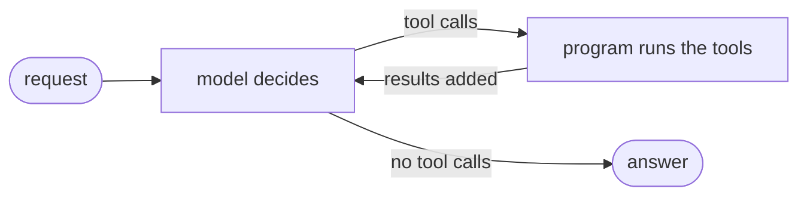

# What is a loop

> The agent loop is the cycle *model decides → program runs the tools → model reads the results*, repeated until the model answers without asking for a tool. It's what turns a single model call into an agent.

## What it is

A single model call answers once, from what the model already knows. Many tasks can't be done that way: the model needs information it doesn't have, and what it asks for next depends on what it learned before. The **loop** lets it work in rounds: ask for something, read the answer, decide again. Each round is a **turn** ([[What is a turn]]).

## Its components

| Component | What it does |
|---|---|
| **the model's decision** | reads everything so far and replies with tool calls, or with a final answer |
| **running the tools** | your program carries out the calls the model asked for ([[What is a tool]]) |
| **the conversation** | every request, call and result, resent on every turn: the model's only memory |
| **a stop condition** | a reply without tool calls is the answer, and the loop ends |
| **a limit** | a maximum number of turns or calls, in case the model never stops |

## How it's implemented

The idea is the same in every framework; what changes is who writes the loop ([[LangChain or LangGraph]]):
- in **LangChain**, `create_agent` runs it for you, as a `model` step and a `tools` step, and you add code at fixed moments ([[The agent loop in LangChain]]);
- in **LangGraph**, you draw it yourself: a model node, a tools node (`ToolNode`), a router after the model (`tools_condition`) and an edge back. The stop condition and the limit are yours to write too ([[The agent loop in LangGraph]]).

## Example

Take a researcher agent that must measure the returns and risk of three funds (equity, bond and cash), with two tools: `get_returns(days)`, for at most 365 days, and `get_volatility(fund)`. It can't decide which funds' risk to check before it has seen their returns, and it can't fix a bad call before it sees the error. So it works in four [[What is a turn|turns]]:
1. it asks for `days=500` and reads the error: at most 365;
2. it asks for `days=90`: equity +4%, bond +1%, cash +0.5%;
3. it asks for the volatility of equity and bond: 15% and 5%;
4. it writes its notes, with no tool call, so the loop ends.

Each need of the loop shows up here: the **conversation** keeps the returns from turn 2 available at turn 4, the error at turn 1 lets it **recover**, and turn 4 is the **stop condition**. A **limit** (say, 8 model calls and 6 tool calls) would stop it if it kept asking for more: middleware in LangChain ([[Limits in LangChain]]), your own count in LangGraph ([[Errors and retries in LangGraph]]).

## Watch out
- **Every turn costs more than the last.** The whole conversation is resent each time, so long loops with big tool results get slow and expensive.
- **A loop without a limit can run forever**, or until something crashes.

## Related
[[LangChain Overview]] · [[LangGraph Overview]] · [[What is a turn]] · [[What is a tool]] · [[The agent loop in LangChain]] · [[The agent loop in LangGraph]] · [[LangChain or LangGraph]]

## My notes & questions
