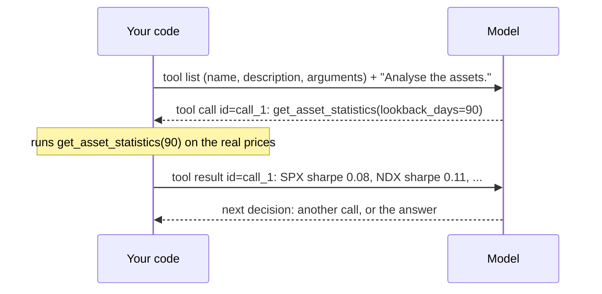

# What is a tool

> A tool is a function the model can't run but can **ask** you to run. The model writes the request, your code runs the function, and the model reads the result.

## Context

In the [[Agents in LangChain#Context|running exampl]], the analyst needs statistics on the prices up to 31 January 2025. At steps 3–4 the model "calls `get_asset_statistics` with 90 days" and "the program runs it". Here is what actually travels between the two *(simplified, numbers made up)*:

The model only ever sends and receives **text**. It didn't open a file or run any code. It wrote a structured request, and your program did the rest.

## The four steps

Every tool call, in every framework, follows the same four steps:

1. **You describe** each tool to the model. A tool has:
	- a **name** (`get_asset_statistics`)
	- a **description** saying what it does and when to use it (the function's docstring)
	- its **arguments** with their types and limits (`lookback_days`: an integer from 5 to 3650).
2. **The model decides.** It replies either with text or with a **tool call**: the tool's name, the argument values, and an **id**.
3. **Your code runs it.** Your program executes the function with those arguments.
4. **The result goes back** to the model as a message carrying the same id, so the model knows which request it answers. The model then decides again.

In LangChain, `create_agent` does step 3 for you ([[Tools in LangChain]]). In LangGraph you add it as a node ([[Tools in LangGraph]]).

## Watch out
- **The model can call it wrong.** It may send bad arguments (`lookback_days=2`) or broken JSON. Check the input ([[Schemas in LangChain]]), and send the error back so the model can retry.
- **Don't let the model choose what it shouldn't.** The reporting date isn't an argument. Your code passes it in (`ToolRuntime`), so the model can't look at prices after 31 January.
- **Every call is a round trip** to the model. A loop needs a limit.

## Related
[[Agents in LangChain]] · [[Tools in LangChain]] · [[Tools in LangGraph]] · [[The agent loop in LangChain]] · [[Schemas in LangChain]]

