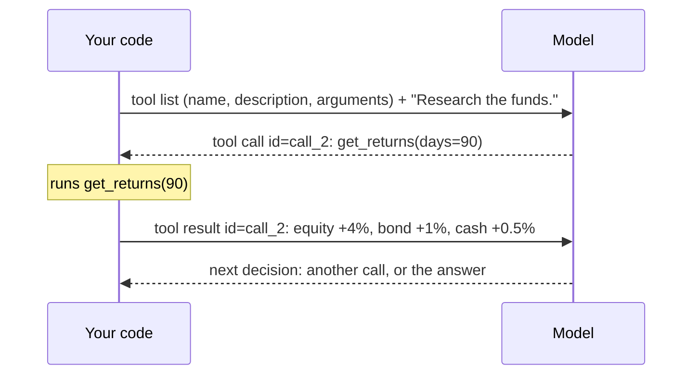

# What is a tool

> A tool is a function the model can't run but can **ask** you to run. The model writes the request, your code runs the function, and the model reads the result.

## Context

In [[The running example]], the researcher needs the funds' returns. A model only reads and writes text: it can't open a database of prices. So at turn 2 it *writes* "call `get_returns` with `days=90`", and our program runs the function. Here is what actually travels between the two:



The model never ran any code. It wrote a structured request, and your program did the rest.

## The four steps

Every tool call, in every framework, follows the same four steps:

1. **You describe** each tool to the model:
	- a **name**: `get_returns`;
	- a **description** of what it does and when to use it: "Total return of every fund over the last `days` days";
	- its **arguments**, with types and limits: `days`, an integer from 5 to 365.
2. **The model decides.** It replies either with text, or with a **tool call**: the tool's name, the argument values, and an **id**.
3. **Your code runs it** with those arguments.
4. **The result goes back** to the model as a message carrying the same id, so the model knows which request it answers. Then the model decides again.

A reply can hold **several** tool calls: at turn 3 the researcher asks for `get_volatility("equity")` and `get_volatility("bond")` at once, and both run before the model is called again.

## Example

How LangChain turns a Python function into that description:

```python
from typing import Literal
from langchain.tools import tool

@tool
def get_volatility(fund: Literal["equity", "bond", "cash"]) -> dict:
    """Annualised volatility of one fund, in %: how much its price moves up and down."""
    ...
```

The function name becomes the tool's name, the docstring its description, and the type hints its arguments ([[Tools in LangChain]]).

## Watch out
- **The model can call it wrong.** At turn 1 it asks for `days=500`. Check the arguments, and send the error back so the model can fix its call ([[Schemas in LangChain]]).
- **Don't let the model choose what it shouldn't.** The list of funds isn't an argument: your code passes it in, so the model can't add a fund that isn't in the mandate.
- **Every call is a round trip** to the model. A loop of tool calls needs a limit ([[Middleware in LangChain]]).

## Related
[[LangChain Overview]] · [[The running example]] · [[What is a turn]] · [[Tools in LangChain]] · [[The agent loop in LangChain]] · [[Schemas in LangChain]]

## My notes & questions
