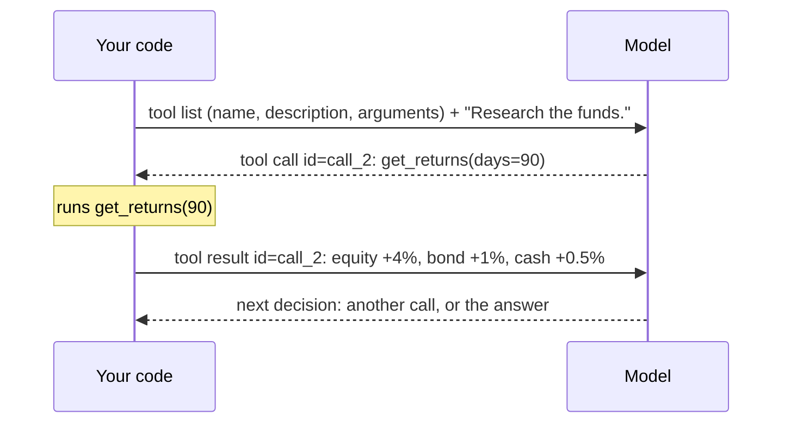

# What is a tool

> A tool is a function the model can't run but can **ask** you to run. The model writes the request, your code runs the function, and the model reads the result.

## What it is

A model only reads and writes text: it can't open a file, query a database or call an API. A **tool** gives it a way to get things done anyway: the model is told which functions exist, and when it needs one it writes a request for it. Your program runs the function and hands the result back. The model never runs any code.

## Its components

| Component | What it is |
|---|---|
| **name** | how the model refers to the tool |
| **description** | what the tool does and when to use it |
| **arguments** | the inputs, with their types and limits |
| **tool call** | the model's request: the tool's name, the argument values, and an **id** |
| **tool result** | what the function returned, sent back with the same id, so the model knows which request it answers |

Every tool call follows the same four steps:
1. **You describe** each tool to the model (name, description, arguments).
2. **The model decides**: it replies either with text, or with one or more tool calls.
3. **Your code runs it** with the arguments the model chose.
4. **The result goes back** to the model, which decides again ([[What is a loop]]).

## How it's implemented

In LangChain, a tool is an ordinary Python function marked with `@tool`: its name becomes the tool's name, its docstring the description, and its type hints the arguments. `create_agent` sends the descriptions to the model and runs the calls for you ([[Tools in LangChain]]):

```python
from typing import Literal
from langchain.tools import tool

@tool
def get_volatility(fund: Literal["equity", "bond", "cash"]) -> dict:
    """Annualised volatility of one fund, in %: how much its price moves up and down."""
    ...
```

In LangGraph, the tool is written the same way, but you do the other two steps yourself: `model.bind_tools([...])` sends the descriptions to the model, and a `ToolNode` in the graph runs the calls ([[Tools in LangGraph]]):

```python
reply = model.bind_tools([get_volatility]).invoke(messages)    # the model may ask for it
graph.add_node("tools", ToolNode([get_volatility]))             # the graph runs it
```

## Example

Take a researcher agent that must report how three funds (equity, bond and cash) have performed. It needs their returns, which it can't fetch itself, so it *writes* a request for the `get_returns` tool, and your program runs it:



A reply can hold **several** tool calls: the researcher can ask for `get_volatility("equity")` and `get_volatility("bond")` at once, and both run in the same [[What is a turn|turn]].

## Watch out
- **The model can call it wrong**, e.g. `days=500` when the limit is 365. Check the arguments, and send the error back so the model can fix its call ([[Schemas in LangChain]], [[Tools in LangGraph]]).
- **Don't let the model choose what it shouldn't.** The list of funds isn't an argument: your code passes it in, so the model can't add a fund it shouldn't use ([[Runtime in LangChain]]; in LangGraph, [[Tools in LangGraph]]).
- **Every call is a round trip** to the model. A loop of tool calls needs a limit ([[Limits in LangChain]], [[Errors and retries in LangGraph]]).

## Related
[[LangChain Overview]] · [[LangGraph Overview]] · [[What is a turn]] · [[Tools in LangChain]] · [[Tools in LangGraph]] · [[The agent loop in LangChain]] · [[The agent loop in LangGraph]]

## My notes & questions
