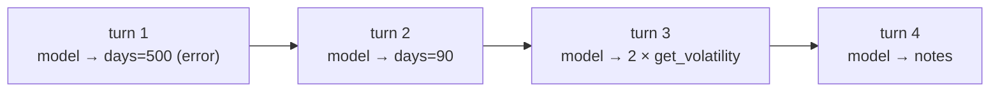

# What is a turn

> A turn is one round of the agent loop ([[What is a loop]]): **one model call**, plus running the tools that call asked for.

## Context

In [[The running example]], the researcher calls `get_returns` twice and `get_volatility` twice, then writes its notes. That's 4 tool calls. But when the agent counts its rounds, it doesn't count tool calls: it counts **how many times it called the model**. Group the run around those calls and you get 4 turns:

| Turn | Model call: the model reads all messages and replies… | …then the tools run |
|---|---|---|
| 1 | "call `get_returns(days=500)`" | rejected: days must be ≤ 365; the error is added to the messages |
| 2 | "call `get_returns(days=90)`" | runs; the returns are added |
| 3 | "call `get_volatility("equity")` and `get_volatility("bond")`" | both run; both results are added |
| 4 | the notes, with no tool call | nothing to run, so the loop ends |

The strategist takes 2 turns (its first answer is rejected), and the writer takes 1.

## The definition

A **turn** is:
1. **one model call**: the model receives the whole conversation so far, and replies;
2. **then the tools it asked for**, if any, are run, and their results added to the conversation.

The next turn starts with the next model call. A reply with no tool calls is the **last turn** ([[The agent loop in LangChain]]).

Turn 3 shows that **one turn can hold several tool calls**: they all run before the next model call.

## Why turns matter: limits count different things

| Limit | Counts | In the researcher's run |
|---|---|---|
| a **model call** limit (`ModelCallLimitMiddleware`) | model calls = **turns** | 4 |
| a **tool call** limit (`ToolCallLimitMiddleware`) | **tool calls**, across all turns | 4 (including the rejected one) |
| the **recursion limit** | **graph steps**: every internal step, including middleware | several per turn |

A **graph step** is smaller than a turn: each turn passes through the model step, the tools step and any middleware hooks ([[Hooks in LangChain]]). That's why a recursion limit has to be much larger than the number of turns you allow.

## Watch out
- **Each turn resends everything.** The model has no memory between calls: every turn it rereads the whole conversation, so more turns cost more time and tokens.
- **"Turn" in chat apps** sometimes means one message from one side. In these notes, a turn is always one model call plus its tools.

## Related
[[LangChain Overview]] · [[The running example]] · [[The agent loop in LangChain]] · [[What is a tool]] · [[Middleware in LangChain]] · [[Hooks in LangChain]]

## My notes & questions
