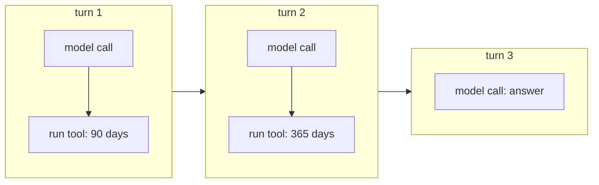

# What is a turn

> A turn is one round of the agent loop: **one model call**, plus running the tools that call asked for.

## Context

The [[Agents in LangChain#Context|running example]] tells the analyst's run in **six example steps**: 
1. the model reads the request
2. sees the tool
3. asks for 90 days
4. the program runs it
5. the model asks for 365 days
6. the model answers. 

That's how a person would tell the story.
The agent doesn't count steps, though. It counts **how many times it called the model**. 

Group the six steps around those calls and you get three:

| Turn | Model call: the model reads all messages and replies… | …then the tools run | Example steps |
|---|---|---|---|
| 1 | "call `get_asset_statistics`, 90 days" | the program runs it, the result is added to the messages | 1, 2, 3, 4 |
| 2 | "call it again, 365 days" | runs again, result added | 5 |
| 3 | the answer (`Analysis`) | nothing to run, so the loop ends | 6 |

So the run is **3 turns**. 
## The definition

A **turn** is:
1. **one model call**: the model receives the whole conversation so far, and replies;
2. **then the tools it asked for**, if any, are run and their results added to the conversation.

The next turn starts with the next model call. A reply with no tool calls is the **last turn** ([[The agent loop in LangChain]]).

One turn can contain **several tool calls**. If the model had asked for 90 and 365 days in the same reply, both would run in turn 1, and the whole run would take 2 turns.

## Why turns matter: the limits count them

The limits in the template count different things. It's easy to mix them up:

| Limit | Counts | In the example run |
|---|---|---|
| `MAX_MODEL_CALLS` (LangChain, 8) | model calls = **turns** | 3 |
| `MAX_TOOL_CALLS` (LangChain, 6) | **tool calls**, across all turns | 2 |
| `MAX_TOOL_ROUNDS` (LangGraph, 4) | turns **that called a tool** | 2 |
| recursion limit (`AGENT_RECURSION_LIMIT` = 100 inside the agent, `RECURSION_LIMIT` = 40 for the workflow) | **graph steps**: every node run, including middleware hooks | several per turn |

A **graph step** is smaller than a turn. Each turn passes through several nodes: the model, the tools, and each middleware hook ([[Hooks in LangChain]]). The template's comment estimates about five graph steps per model call. That's why the recursion limit is much larger than the number of turns.

## Watch out
- **Each turn resends everything.** The model has no memory between calls. Every turn it rereads the whole conversation, so more turns cost more time and tokens.
- **"Turn" in chat apps** sometimes means a single message from one side (user *or* assistant). In these notes, a turn is always one model call plus its tools.

## Related
[[The agent loop in LangChain]] · [[Agents in LangChain]] · [[What is a tool]] · [[Middleware in LangChain]] · [[Hooks in LangChain]]

